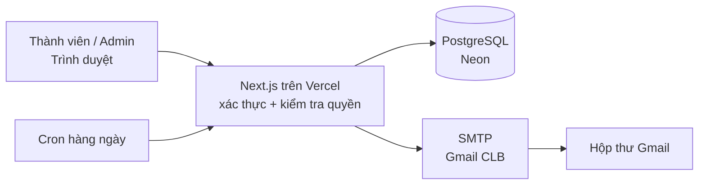
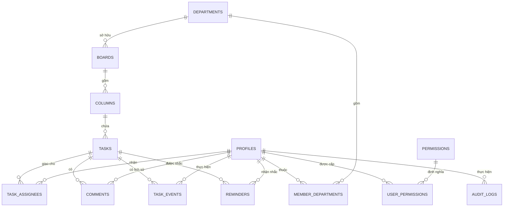

# HANDOFF: Website nội bộ quản lý thành viên & giao task cho CLB

| Mục | Nội dung |
|---|---|
| Phiên bản tài liệu | 1.3 (bản chốt yêu cầu, có đề xuất chờ xác nhận) |
| Ngày lập | 2026-11-20 |
| Trạng thái dự án | **Lập kế hoạch**: yêu cầu đã chốt, sẵn sàng bắt đầu giai đoạn 0 (chưa có mã nguồn) |
| Chủ sở hữu yêu cầu | Sang (người đề xuất dự án) |
| Ngôn ngữ giao diện | Tiếng Việt (cần xác nhận, xem mục 14) |

> **Quy ước:** mục nào ghi **[Đề xuất]** là khuyến nghị kỹ thuật, **chưa được chủ dự án xác nhận**. Mục ghi **[Yêu cầu]** là yêu cầu do chủ dự án nêu trực tiếp.

**Lịch sử thay đổi**

| Phiên bản | Ngày | Thay đổi |
|---|---|---|
| 0.1 | 2026-11-20 | Bản đầu tiên |
| 0.2 | 2026-11-20 | Đổi nghiệp vụ phân quyền: bỏ 3 vai trò cố định, **admin chọn từng quyền cho từng tài khoản** (mục 3, 4, 8.1, 8.6, 9, 12, 13, 14) |
| 0.3 | 2026-11-20 | Đổi nghiệp vụ: **mọi thành viên xem được task chung**; **đăng nhập bằng MSSV, bỏ OTP**; đổi sang **CSDL tương thích MySQL** (đề xuất TiDB Cloud Starter) và chuyển kiểm tra quyền xuống tầng ứng dụng (mục 3.4, 4, 6, 7, 8.1, 8.2, 8.6, 9, 12, 13, 14) |
| 0.4 | 2026-11-20 | **Đổi CSDL về PostgreSQL** (đề xuất Neon); RLS quay lại làm lớp dự phòng bên cạnh kiểm tra quyền ở ứng dụng; cập nhật rủi ro, quyết định, câu hỏi (mục 3.2, 5, 6, 7, 8, 9, 10, 11, 12, 13, 14, 16) |
| 0.5 | 2026-11-20 | Chốt: **Neon**; **đăng nhập MSSV thuần cho mọi tài khoản** (hạ mức bảo mật vì hệ thống nội bộ); thêm **cờ ẩn task**; admin nhập email mọi thành viên; `member.view` cấp mặc định cho mọi tài khoản; RLS dự phòng dời sang giai đoạn 2 (mục 3, 4, 7, 8, 11, 12, 13, 14) |
| 0.6 | 2026-11-20 | Chốt: làm một mình + AI theo backlog, Next.js, email `@eiu.edu.vn`, session 15 phút, giống Trello + priority, mốc nhắc do admin cấu hình, song ngữ Việt/Anh, quyền mặc định + mẫu quyền, không ủy quyền cấp quyền, admin có quyền cao nhất; thêm mục 11.1 (cách làm việc với AI) và câu hỏi mới Q26–Q29 (mục 3, 4, 5, 6, 7, 8, 9, 11, 12, 13, 14, 16) |
| 0.7 | 2026-11-20 | Thêm **kế hoạch phát triển phần mềm theo hướng thiết kế trước**: wireframe, CSDL, API (mục 11.2–11.8); thêm tuần 0 vào lộ trình; viết lại mục 16 |
| 0.8 | 2026-11-20 | Chuyển sang **mô hình nhóm agent AI** (Project Leader, Frontend, Backend, QA): vai trò, vùng sở hữu file, vòng đời backlog item, quy tắc phối hợp, phân công theo epic (mục 6, 11.1, 11.2, 11.6, 11.7, 11.8, 12, 13, 14, 16) |
| 0.9 | 2026-11-20 | **Quay về một agent AI (harness DeepSeek) làm tuần tự theo backlog**, chủ dự án duyệt trước khi merge; chốt: 20 ban và một người thuộc nhiều ban, quyền toàn CLB và vĩnh viễn, 2 admin, nhập thành viên bằng tay, lưu trữ dữ liệu thành viên cũ, email riêng của CLB, session hết hạn trượt, Trello ở mức thiết yếu và thiết kế mở, admin sửa được hết; thêm mục 11.9 (thiết kế mở) và câu hỏi Q32–Q34 (mục 3, 4, 5, 7, 8, 11, 12, 13, 14, 16) |
| 1.0 | 2026-11-21 | Chốt nốt câu hỏi mở: cờ ẩn do người tạo task và admin bật/tắt (bỏ quyền `task.hide`), chưa làm báo cáo cuối năm, wireframe giao AI làm riêng theo `WIREFRAME-BRIEF.md`, tự căn chỉnh harness; không còn câu hỏi mở (mục 3, 4, 11, 13, 14, 16) |
| 1.1 | 2026-11-22 | Bỏ hết hạn session 15 phút và hộp nhập lại MSSV (S02); thay bằng ô "Ghi nhớ đăng nhập" ở màn hình đăng nhập kèm hạn tối đa phía server (mục 4, 8.2, 9, 11, 12, 13, 14) |
| 1.2 | 2026-11-22 | Thêm mục 8.7 (kiến trúc phần mềm và mẫu thiết kế bắt buộc, chống over-engineering) và mục 6A trong `AGENTS.md`; thêm design note và checklist thiết kế vào quy trình; cập nhật cấu trúc repo, E1, CI, rủi ro R17, quyết định D34 (mục 8.7, 11, 12, 13) |
| 1.3 | 2026-11-22 | Thêm **lịch sử hoạt động (history tracking)** và **hoàn tác (undo) task** kèm Thùng rác: FR-60 đến FR-62, bảng `task_events`, mục 8.8 (gồm so sánh phương án công nghệ), endpoint, màn hình S15, AC-16 đến AC-22, epic E7A, rủi ro R18 đến R20, quyết định D35 đến D37, câu hỏi Q36 đến Q39 (mục 4, 8, 11, 12, 13, 14) |

---

## 1. Tóm tắt dự án

Xây dựng một website nội bộ cho một câu lạc bộ (CLB) khoảng **50 thành viên**, dùng để:

1. Quản lý thành viên (hồ sơ, ban, quyền truy cập do admin chọn).
2. Giao và theo dõi task, hiển thị dạng bảng kiểu Trello.
3. Tự động gửi email nhắc khi task sắp đến hạn.

Ưu tiên: **công nghệ ổn định, chi phí thấp hoặc miễn phí**.

## 2. Mục tiêu, phạm vi, ngoài phạm vi

### 2.1 Mục tiêu
- Thay thế việc giao việc rời rạc (chat, bảng tính) bằng một nơi tập trung.
- Giảm trễ deadline nhờ nhắc tự động.
- Vận hành với chi phí **0đ/tháng** trong điều kiện sử dụng bình thường.

### 2.2 Trong phạm vi (MVP)
- Đăng nhập bằng MSSV, quản trị thành viên và **cấp quyền theo từng tài khoản** bởi admin.
- Board/cột/thẻ task, kéo thả, bình luận.
- Nhắc deadline qua email.

### 2.3 Ngoài phạm vi (giai đoạn 2, chưa cam kết)
- Điểm danh sự kiện, báo cáo đóng góp, lịch họp, upload file, thông báo qua Zalo/Discord, ứng dụng di động native.

## 3. Các bên liên quan & mô hình phân quyền

### 3.1 Đối tượng

| Đối tượng | Mô tả |
|---|---|
| Admin (hiện có 2 người: chủ dự án và chủ CLB) | Tài khoản có cờ `is_admin`. Có toàn bộ quyền; là người **duy nhất** cấp/thu hồi quyền và cấp/gỡ cờ admin; **có quyền cao nhất**: vượt mọi kiểm tra quyền, xem/sửa mọi task kể cả task ẩn |
| Tài khoản thường | Chỉ có đúng những quyền mà admin đã chọn cho tài khoản đó |

> **Thay đổi ở v0.2 [Yêu cầu]:** bỏ 3 vai trò cố định (Admin / Trưởng ban / Thành viên) của v0.1. Admin chọn từng quyền cho từng tài khoản. "Trưởng ban", "Thành viên"... nếu còn dùng thì chỉ là *tên của mẫu quyền* (mục 3.5), không còn là cơ chế kiểm soát truy cập.

### 3.2 Nguyên tắc phân quyền **[Đề xuất]**

1. **Mặc định từ chối:** không được cấp quyền thì không làm được.
2. **Chỉ cộng dồn:** quyền của tài khoản là hợp các quyền được cấp; không có quyền "cấm" riêng.
3. **Chỉ admin cấp/thu hồi quyền.** Việc cấp quyền không thể giao cho tài khoản khác, kể cả tài khoản có `member.update`.
4. **Hiệu lực ngay:** cấp hoặc thu hồi quyền có tác dụng từ request kế tiếp, không cần đăng nhập lại.
5. **Luôn còn ít nhất một admin đang hoạt động.**
6. **Tầng server của ứng dụng là lớp kiểm tra chính**, RLS của PostgreSQL là lớp dự phòng ở giai đoạn 2 (mục 8.6). Ẩn nút trên giao diện chỉ để tiện dùng, không phải biện pháp bảo mật.
7. **Mẫu quyền chỉ là lối tắt:** áp mẫu = sao chép thành các quyền riêng của tài khoản; sửa mẫu về sau không tự đổi các tài khoản đã áp.
8. **Admin có quyền cao nhất [Yêu cầu, v0.6; Q29 ở v0.9: admin sửa được hết]:** vượt qua mọi kiểm tra quyền, xem và sửa được mọi task (kể cả task ẩn), mọi bình luận và mọi thành phần quản trị (board, cột, ban, thành viên, cấu hình). *(Đề xuất: nhật ký quản trị chỉ ghi thêm, không sửa/xóa, kể cả với admin, để còn truy lại được.)*

### 3.3 Danh mục quyền (permission catalog) **[Đề xuất]**

| Mã quyền | Nhóm | Mô tả |
|---|---|---|
| `member.view` | Thành viên | Xem danh sách thành viên (họ tên, ban) |
| `member.view_detail` | Thành viên | Xem MSSV, email, thông tin liên hệ (MSSV dùng để đăng nhập nên là thông tin nhạy cảm) |
| `member.create` | Thành viên | Thêm tài khoản thành viên mới |
| `member.update` | Thành viên | Sửa hồ sơ thành viên, gán ban |
| `member.deactivate` | Thành viên | Khóa / mở khóa tài khoản (thành viên rời CLB) |
| `department.manage` | Ban | Tạo/sửa/xóa ban |
| `board.create` | Board | Tạo board |
| `board.update` | Board | Sửa board, thêm/sửa/xóa/sắp xếp cột |
| `board.delete` | Board | Lưu trữ/xóa board |
| `task.create` | Task | Tạo task |
| `task.assign` | Task | Giao / bỏ giao người nhận |
| `task.update_any` | Task | Sửa, di chuyển mọi task |
| `task.update_assigned` | Task | Sửa, di chuyển task được giao cho chính mình |
| `task.delete` | Task | Xóa task |
| `comment.create` | Bình luận | Bình luận ở mọi task nhìn thấy |
| `comment.delete_any` | Bình luận | Xóa bình luận của người khác |
| `reminder.configure` | Hệ thống | Chỉnh mốc nhắc deadline |
| `audit.view` | Hệ thống | Xem nhật ký quản trị và thay đổi quyền |

Mọi quyền **áp dụng toàn CLB** và được cấp **vĩnh viễn** cho đến khi admin thu hồi (Q14, Q18 ở v0.9). Không có phạm vi theo ban, không có hạn quyền. Cờ ẩn của task do **người tạo task và admin** bật/tắt, không cần quyền riêng (Q25b, v1.0).

**Chỉ admin, không nằm trong danh mục cấp được:** cấp/thu hồi quyền; cấp/gỡ cờ admin.

### 3.4 Khả năng xem dữ liệu và phạm vi quyền

**Xem task chung [Yêu cầu, v0.3]:** mọi tài khoản đang hoạt động đều xem được **mọi task không bị ẩn** ở chế độ chỉ đọc, không cần quyền riêng. Việc sửa, di chuyển, giao, xóa vẫn theo quyền được cấp (mục 3.3).

**Task ẩn [Yêu cầu, v0.5]:** task có cờ ẩn (`is_hidden`) **chỉ hiển thị cho những người được giao task đó**. *(Đã xác nhận v0.6: admin và người tạo task cũng xem được; v1.0: chỉ người tạo task và admin bật/tắt được cờ ẩn.)* Với người không có quyền xem, task ẩn không xuất hiện ở board, tìm kiếm, bình luận, số đếm, API và dữ liệu xuất; email nhắc deadline của task ẩn chỉ gửi cho người được giao. Người bị bỏ khỏi danh sách giao thì mất quyền xem task ẩn đó. Quyền `task.update_any` không cho phép xem hoặc sửa task ẩn mà mình không được xem.

**Không lộ định danh đăng nhập:** vì MSSV là thứ dùng để đăng nhập (mục 8.2), các màn hình task, bình luận, bảng board chỉ hiện **họ tên**; MSSV và email chỉ hiện cho tài khoản có `member.view_detail`. Quy tắc này áp dụng cả cho API và dữ liệu xuất ra.

**Phạm vi quyền [Yêu cầu, v0.9]:** quyền áp dụng toàn CLB (xem mục 3.3). Ban (20 ban, một người có thể thuộc nhiều ban) chỉ dùng để tổ chức: nhóm board, lọc và hiển thị thành viên, không giới hạn quyền.

### 3.5 Mẫu quyền gợi ý (preset) **[Đề xuất, chưa xác nhận]**

| Mẫu | Gồm các quyền |
|---|---|
| Thành viên cơ bản | `member.view`, `task.update_assigned`, `comment.create` |
| Trưởng ban | Thành viên cơ bản + `member.view_detail`, `board.create`, `board.update`, `task.create`, `task.assign`, `task.update_any` |
| Quản lý nhân sự | Thành viên cơ bản + `member.view_detail`, `member.create`, `member.update`, `member.deactivate` |

## 4. Yêu cầu chức năng

### 4.1 [Yêu cầu] Do chủ dự án nêu
| ID | Yêu cầu |
|---|---|
| FR-01 | Giao task cho thành viên |
| FR-02 | Tự động gửi email khi task sắp đến hạn |
| FR-03 | Có bảng giao task giống Trello |
| FR-04 | Tài khoản do **admin đăng ký**; **đăng nhập bằng cách nhập MSSV**, không có bước xác thực OTP (đổi ở v0.3) |
| FR-06 | **Mọi thành viên đều xem được task chung**: mọi task không bị ẩn, chỉ đọc (v0.3) |
| FR-07 | **Cờ ẩn task:** task có cờ ẩn chỉ người được giao (và admin, người tạo task; đã xác nhận v0.6) xem được (v0.5); chỉ người tạo task và admin bật/tắt được cờ ẩn (v1.0) |
| FR-05 | **Admin chọn những quyền mà mỗi tài khoản có được** (thay cho vai trò cố định) |

### 4.2 [Đề xuất] Chi tiết hóa
| ID | Yêu cầu | Ưu tiên |
|---|---|---|
| FR-10 | Admin thêm/sửa/khóa thành viên (MSSV, họ tên, ban, **email bắt buộc do admin nhập sẵn, phải thuộc tên miền `@eiu.edu.vn`**) | Must |
| FR-11 | Chỉ MSSV do admin đã đăng ký và tài khoản đang active mới đăng nhập được | Must |
| FR-12 | Kiểm soát truy cập theo quyền được cấp cho từng tài khoản (mục 3); mặc định từ chối | Must |
| FR-13 | Quản lý ban (CLB có 20 ban); một thành viên có thể thuộc nhiều ban (thực tế tối đa 2) | Must |
| FR-14 | Trang quản trị phân quyền: admin chọn/bỏ từng quyền (theo danh mục mục 3.3) cho từng tài khoản | Must |
| FR-15 | Quyền có hiệu lực ngay sau khi admin lưu, không cần người dùng đăng nhập lại | Must |
| FR-16 | Ghi nhật ký (audit log) mọi thay đổi quyền và hành động quản trị | Must |
| FR-17 | Mẫu quyền (preset) để áp nhanh một bộ quyền cho tài khoản mới (theo Q15) | Must |
| FR-18 | Chỉ admin cấp/thu hồi quyền; luôn còn ít nhất một admin hoạt động | Must |
| FR-19 | Mọi tài khoản mới mặc định được cấp `member.view`, `task.update_assigned`, `comment.create` (mẫu "Thành viên cơ bản"); admin thu hồi/điều chỉnh được từng tài khoản | Must |
| FR-20 | CRUD board và cột; cột mặc định Todo/Doing/Review/Done | Must |
| FR-21 | CRUD task: tiêu đề, mô tả, hạn chót, mức ưu tiên, nhiều người nhận | Must |
| FR-22 | Kéo thả thẻ giữa các cột và đổi thứ tự trong cột | Must |
| FR-23 | Trang "Task của tôi" | Must |
| FR-24 | Bình luận trong task | Should |
| FR-25 | Lọc/tìm kiếm theo người, hạn, ưu tiên, trạng thái | Should |
| FR-26 | Task ẩn không lộ qua board, tìm kiếm, số đếm, bình luận, API, email nhắc (lọc ở mọi truy vấn phía server, không chỉ ở giao diện) | Must |
| FR-27 | **Priority của task** (chủ CLB yêu cầu thêm so với Trello): 4 mức Thấp / Trung bình / Cao / Khẩn *(đã chốt v0.9)*; hiển thị nhãn màu trên thẻ, lọc và sắp xếp theo priority | Must |
| FR-30 | Email nhắc deadline ở các mốc **do admin cấu hình** (mặc định: còn 2 ngày, còn 1 ngày) và nhắc task quá hạn | Must |
| FR-31 | Gộp nhiều task thành một email mỗi người; không gửi trùng | Must |
| FR-40 | Đăng nhập có ô **"Ghi nhớ đăng nhập"** (mặc định không tích): không tích thì cookie phiên (mất khi đóng trình duyệt) kèm hạn tối đa phía server `SESSION_TTL_DEFAULT` (đề xuất 24 giờ); tích thì sống `SESSION_TTL_REMEMBER` (đề xuất 30 ngày, gia hạn khi dùng); hết hạn thì về màn hình đăng nhập kèm thông báo (v1.1, thay hết hạn 15 phút) | Must |
| FR-41 | Giới hạn số lần thử đăng nhập theo IP ở mức nhẹ; ghi log đăng nhập | Should |
| FR-42 | MSSV và email chỉ hiển thị cho tài khoản có `member.view_detail` (giao diện, API, dữ liệu xuất) | Must |
| FR-43 | Khi thành viên rời CLB: admin khóa tài khoản (`is_active=false`, ghi `left_at`); dữ liệu và task của họ được **giữ nguyên** (không xóa) để làm báo cáo cuối năm; tên hiển thị kèm "(đã rời)"; không nhận nhắc deadline | Must |
| FR-50 | Giao diện **song ngữ Việt/Anh**; mỗi người chọn ngôn ngữ; email nhắc gửi theo ngôn ngữ đã chọn | Must |
| FR-60 | **Lịch sử hoạt động của task (history tracking)** *(đề xuất, Q37–Q38)*: ghi mọi thay đổi (tạo; sửa tiêu đề, mô tả, priority, hạn; đổi cột/vị trí; đổi người được giao; bật/tắt ẩn; xóa/khôi phục; thêm/xóa bình luận) kèm ai, khi nào, giá trị trước và sau; hiển thị ở tab "Lịch sử" của chi tiết task; **chỉ ghi thêm**, không ai sửa/xóa; tuân thủ quy tắc task ẩn và FR-42 | Must |
| FR-61 | **Hoàn tác (undo) task** *(đề xuất, Q37)*: (a) ngay sau thao tác, hiện thông báo có nút "Hoàn tác" trong 10 giây; (b) từ tab Lịch sử, nút "Khôi phục giá trị này" cho từng thay đổi hoàn tác được. Hoàn tác tạo **sự kiện mới** (không xóa lịch sử), cần đúng quyền của thao tác gốc, và bị chặn (409) nếu task đã bị sửa tiếp trừ khi người dùng xác nhận đặt lại. Không hoàn tác bình luận và thao tác quản trị | Must |
| FR-62 | **Xóa mềm và Thùng rác** *(đề xuất, Q39)*: xóa task chỉ đặt `deleted_at`; task rời khỏi board và các truy vấn thường; người có `task.delete` và admin xem và khôi phục được ở Thùng rác của board; không xóa vĩnh viễn trong MVP | Must |

## 5. Yêu cầu phi chức năng

| ID | Hạng mục | Yêu cầu |
|---|---|---|
| NFR-01 | Quy mô | ~50 người dùng, khoảng 10–20 người đồng thời |
| NFR-02 | Chi phí | 0đ/tháng trên free tier (tên miền riêng là tùy chọn) |
| NFR-03 | Sẵn sàng | Best-effort, không cam kết SLA; chấp nhận gián đoạn ngắn |
| NFR-04 | Bảo mật | Không đăng ký công khai; kiểm tra quyền ở tầng server cho mọi truy vấn, RLS PostgreSQL là lớp dự phòng ở giai đoạn 2; CSDL chỉ truy cập từ server, trình duyệt không kết nối trực tiếp; khóa bí mật chỉ ở server; HTTPS bắt buộc |
| NFR-05 | Dữ liệu cá nhân | Chỉ lưu dữ liệu cần thiết (email, họ tên, MSSV, ban); không công khai ra ngoài CLB. Dữ liệu thành viên cũ và task của họ được lưu trữ (không xóa) để làm báo cáo cuối năm; nên cho thành viên biết mục đích lưu khi tạo tài khoản |
| NFR-06 | Sao lưu | Xuất database tối thiểu mỗi tuần, lưu ở nơi khác nền tảng chính |
| NFR-07 | Giao diện | Responsive, dùng tốt trên điện thoại |
| NFR-08 | Bảo trì | Tài liệu đủ để người kế nhiệm tiếp quản; tài khoản dịch vụ thuộc CLB, không thuộc cá nhân |
| NFR-09 | Email | Email nhắc deadline đến hộp thư chính (không vào spam) |
| NFR-10 | Đa ngôn ngữ | Mọi chuỗi giao diện và email nằm trong tệp ngôn ngữ (vi/en); thêm ngôn ngữ không cần sửa mã nghiệp vụ |

## 6. Ràng buộc & giả định

**Ràng buộc**
- Ngân sách gần như bằng 0; phải dùng dịch vụ có gói miễn phí.
- Chỉ một người chủ trì (chủ dự án, sinh viên, làm bán thời gian); công việc phát triển do một agent AI (harness DeepSeek) thực hiện tuần tự theo backlog, chủ dự án duyệt trước khi merge (mục 11.1).

**Giả định (cần kiểm chứng)**
- Giới hạn free tier của Vercel, nhà cung cấp PostgreSQL, dịch vụ email có thể thay đổi; **phải kiểm tra lại trang giá chính thức trước khi chốt**. Số liệu ở mục 7.3 lấy từ các trang tổng hợp/tài liệu công bố tháng 10–11/2026 và có chỗ lệch nhau giữa các nguồn.
- Mỗi gói free PostgreSQL giới hạn một thứ khác nhau (dung lượng nhỏ, tự ngủ hoặc tạm dừng khi không hoạt động), xem mục 7.3.
- Vì đăng nhập bằng MSSV nên không dùng dịch vụ xác thực có sẵn của nhà cung cấp CSDL; xác thực và session do ứng dụng tự quản (mục 8.2).

## 7. Kiến trúc đề xuất **[Đề xuất]**

### 7.1 Tech stack

| Tầng | Lựa chọn | Lý do |
|---|---|---|
| Frontend + Backend | Next.js (React, TypeScript), **đã chốt v0.6** | Phổ biến, ổn định, một codebase |
| Hosting | Vercel (hoặc Cloudflare Pages) | Free, deploy tự động từ GitHub |
| Database | PostgreSQL trên Neon (**đã chốt v0.5**; phương án dự phòng: Supabase hoặc Aiven free PostgreSQL) | Miễn phí, PostgreSQL chuẩn; xem mục 7.3 |
| ORM / truy vấn | Prisma hoặc Drizzle (PostgreSQL) | Kiểu dữ liệu rõ ràng, migration trong repo |
| Đa ngôn ngữ | next-intl (hoặc thư viện i18n tương đương) | Song ngữ Việt/Anh ngay từ đầu (FR-50) |
| Xác thực / session | Tự xây trong Next.js: cookie session ký/mã hóa (ví dụ iron-session hoặc Auth.js Credentials) | MSSV không khớp với dịch vụ xác thực dựa trên email |
| Kéo thả | `@hello-pangea/dnd` hoặc `@dnd-kit` | Thư viện kéo thả phổ biến cho React |
| Gửi email | SMTP của **email riêng của CLB** (đã chốt Q26; nếu là Gmail thì dùng App Password) | Không cần tên miền; có thể chuyển Resend/Brevo sau |
| Job định kỳ | Vercel Cron (1 lần/ngày) hoặc GitHub Actions theo lịch | Đủ cho nhắc theo ngày |
| Mã nguồn | GitHub (private) | Free |

**Phương án thay thế đã cân nhắc**
- *Spring Boot + PostgreSQL + React*: hợp với Java, nhưng hosting miễn phí kém ổn định hơn (dịch vụ free có thể "ngủ"; Oracle Cloud Always Free cần tự vận hành).
- *Notion/Airtable/Trello*: nhanh nhưng khó tùy biến phân quyền, đăng nhập bằng MSSV và nhắc deadline theo ý muốn.

### 7.2 Sơ đồ tổng quan



### 7.3 Nhà cung cấp PostgreSQL (đã chọn Neon, v0.5)

Đối chiếu các trang tổng hợp/tài liệu công bố tháng 10–11/2026. Số liệu giữa các nguồn lệch nhau đôi chỗ và chính sách free tier đổi thường xuyên, nên phải kiểm tra lại trang giá chính thức trước khi chốt.

| Lựa chọn | Gói free | Điểm mạnh | Lưu ý |
|---|---|---|---|
| **Neon** (đã chọn) | Không cần thẻ; khoảng 0,5–1 GB mỗi project (các nguồn ghi khác nhau); hạn mức compute theo giờ mỗi tháng | PostgreSQL chuẩn; tự ngủ khi rảnh và **tự thức dậy ở truy vấn đầu**, không cần vào bảng điều khiển bật lại; hợp với Vercel | Truy vấn đầu sau thời gian rảnh chậm hơn vài trăm mili giây; hạn mức đọc theo ngày bị chạm thì truy vấn lỗi đến kỳ reset |
| Supabase (chỉ dùng làm PostgreSQL) | 500 MB; tối đa 2 project hoạt động | Quản trị dễ, có SQL editor | **Tự tạm dừng sau 1 tuần không hoạt động** (kỳ nghỉ dài sẽ làm web ngừng đến khi bật lại); backup tự động không có ở gói free; có API dữ liệu mở mặc định (xem lưu ý bên dưới) |
| Aiven free PostgreSQL | 1 GB, 1 CPU, 1 GB RAM | Có sao lưu tự động theo trang giới thiệu | Tự tắt khi không hoạt động và phải bật lại; không có hỗ trợ kỹ thuật |
| Tự vận hành PostgreSQL trên máy chủ sẵn có | 0đ nếu có máy | Toàn quyền | Tự lo cập nhật, backup, bảo mật; rủi ro bàn giao cao (R5) |

**Lưu ý khi dùng PostgreSQL**
- Đăng nhập MSSV là tự xây, nên **không dùng Supabase Auth** và không dựa được vào `auth.uid()` trong chính sách RLS; xem mục 8.6.
- Nếu dùng Supabase: chỉ kết nối từ server bằng chuỗi kết nối, **không đưa khóa công khai vào trình duyệt**, và tắt hoặc khóa API dữ liệu tự động (hoặc bật RLS cho mọi bảng và không cấp chính sách cho vai trò công khai). Cần đối chiếu tài liệu hiện hành của Supabase vì bảng không được bảo vệ có thể bị đọc qua API này (R11).
- Có trigger và ràng buộc ở CSDL, nên quy tắc "luôn còn ít nhất một admin" làm được ngay tại CSDL.
- Sao lưu bằng `pg_dump` định kỳ và **thử khôi phục ít nhất một lần**.

## 8. Thiết kế chi tiết

### 8.1 Mô hình dữ liệu



| Bảng | Cột chính |
|---|---|
| `profiles` | id, **student_id (MSSV, unique, dùng để đăng nhập)**, email (bắt buộc, admin nhập, dùng gửi nhắc), full_name, is_admin, is_active, left_at, locale (`vi`/`en`) |
| `login_attempts` | id, student_id, ip, success, created_at (phục vụ giới hạn thử và nhật ký đăng nhập) |
| `app_settings` | key, value (jsonb), updated_by, updated_at (ví dụ mốc nhắc deadline do admin cấu hình) |
| `departments` | id, name |
| `member_departments` | user_id, department_id (khóa chính kép; một người thuộc nhiều ban, thực tế tối đa 2) |
| `permissions` | code (PK), group_name, description, scopable (bool); nạp sẵn bằng migration |
| `user_permissions` | user_id, permission_code, granted_by, granted_at; khóa chính (user_id, permission_code); quyền toàn CLB, không hết hạn |
| `permission_presets`, `preset_permissions` | id, name; (preset_id, permission_code) |
| `audit_logs` | id, actor_id, action, target_user_id, detail (jsonb), created_at |
| `boards` | id, name, department_id (tùy chọn, để nhóm board theo ban), created_by, archived_at |
| `columns` | id, board_id, name, order_index |
| `tasks` | id, board_id, column_id, title, description, due_at (timestamptz), priority (smallint: 1 Thấp … 4 Khẩn), position (numeric), **is_hidden (bool)**, version (int), deleted_at, created_by, created_at, updated_at |
| `task_assignees` | task_id, user_id (khóa chính kép) |
| `comments` | id, task_id, user_id, body, created_at |
| `task_events` | id, task_id, board_id, actor_id, type, changes (jsonb: trường -> trước/sau), reverts_event_id (null), forced (bool), created_at; **chỉ ghi thêm** |
| `reminders` | task_id, user_id, kind (`d2`/`d1`/`overdue`), sent_at (unique theo task_id + user_id + kind) |

Ghi chú thiết kế:
- Cột `role` của v0.1 được **bỏ**; thay bằng `is_admin` và bảng `user_permissions`.
- `position` kiểu số thực để chèn giữa hai thẻ mà không phải cập nhật lại cả cột.
- Lưu thời gian dạng UTC, hiển thị theo `Asia/Ho_Chi_Minh`.
- Ràng buộc unique trên `reminders` để đảm bảo không gửi trùng (idempotent).
- Thêm quyền mới = thêm một dòng `permissions` qua migration + cập nhật test (mục 9).
- Khóa chính dùng UUID hoặc bigint identity.
- Task ẩn được lọc trong **mọi** truy vấn danh sách, tìm kiếm và đếm ở server (điều kiện: `is_hidden = false` hoặc người xem là người được giao/được phép) và `deleted_at IS NULL` (task đã xóa mềm chỉ hiện ở Thùng rác).
- `task_events` chỉ ghi thêm: không `UPDATE`/`DELETE` (chặn ở CSDL bằng thu hồi quyền hoặc trigger, kèm kiểm tra ở mã). Chỉ lưu id người/cột/người được giao, **không lưu tên, MSSV, email**; tên hiển thị được giải mã khi đọc qua mapper.

### 8.2 Luồng đăng nhập bằng MSSV (FR-04, FR-11, FR-40, FR-41)

```mermaid
sequenceDiagram
    participant U as Người dùng
    participant W as Next.js (server)
    participant D as CSDL (PostgreSQL)
    U->>W: Nhập MSSV (tích hoặc không tích Ghi nhớ đăng nhập)
    W->>D: Kiểm tra giới hạn thử; tìm profile theo MSSV
    D-->>W: profile (is_active) hoặc không có
    W->>D: Ghi login_attempts
    W-->>U: Cookie session nếu hợp lệ; thông báo chung nếu không
```

Quy tắc:
- Không có đăng ký công khai; MSSV phải do admin tạo trước. Không có bước OTP.
- Thông báo lỗi giống nhau dù MSSV không tồn tại hay tài khoản bị khóa (tránh dò MSSV hợp lệ).
- Giới hạn số lần thử theo IP ở mức nhẹ; ghi `login_attempts` (FR-41).
- **Ô "Ghi nhớ đăng nhập" (v1.1)** trên màn hình đăng nhập, **mặc định không tích**, kèm dòng nhắc "Chỉ tích trên thiết bị của bạn". **Không tích:** cookie phiên (mất khi đóng trình duyệt) và hạn tối đa phía server `SESSION_TTL_DEFAULT` (đề xuất 24 giờ kể từ lúc đăng nhập). **Tích:** cookie sống `SESSION_TTL_REMEMBER` (đề xuất 30 ngày, gia hạn mỗi khi dùng). Hai giá trị là cấu hình, chủ dự án chỉnh được. Vẫn cần hạn phía server vì cookie phiên của trình duyệt không phải cơ chế bảo mật đáng tin (trình duyệt có thể khôi phục phiên, cookie bị lộ sẽ không bao giờ hết hiệu lực).
- Cookie `HttpOnly`, `Secure`, `SameSite`; hết hạn thì về màn hình đăng nhập kèm thông báo (không còn hộp nhập lại MSSV giữa trang, không giữ nội dung đang soạn); dùng thư viện đã được kiểm chứng, không tự chế mật mã.
- Mỗi request đọc lại `profiles` (is_active, is_admin) và quyền, để khóa tài khoản hoặc thu hồi quyền có hiệu lực ngay.
- MSSV không hiển thị ra giao diện/API cho người không có `member.view_detail` (FR-42).

**Quyết định về mức bảo mật (v0.5) [Yêu cầu]:** hệ thống nội bộ nên mức bảo mật không cần cao; **đăng nhập bằng MSSV thuần cho mọi tài khoản**, kể cả admin, không mật khẩu/PIN, không OTP.

Hệ quả đã được chủ dự án chấp nhận (R10): MSSV không phải bí mật, nên ai biết MSSV của người khác đều đăng nhập được thành người đó, bao gồm đổi quyền (nếu là admin), sửa/xóa task, xem thông tin cá nhân và xem các task ẩn của người bị mạo danh.

Các biện pháp **rẻ, vẫn giữ** để rủi ro không tệ hơn mức cần thiết:
1. MSSV và email không hiển thị cho người không có `member.view_detail` (FR-42): vì task chung hiện cho mọi người, đây là cách giữ danh sách MSSV khỏi bị lộ ngay trên hệ thống.
2. Giới hạn nhẹ số lần thử theo IP và ghi log đăng nhập (FR-41).
3. Nhật ký thay đổi quyền và hành động quản trị (FR-16) để truy lại khi có việc bất thường.
4. Admin khóa nhanh được tài khoản.

**Nâng cấp về sau (giai đoạn 2, nếu cần):** thêm mật khẩu/PIN cho mọi tài khoản hoặc chỉ cho admin/tài khoản quyền nhạy cảm. Thiết kế hiện tại cho phép thêm bằng việc bổ sung cột và một bước đăng nhập, không phải đổi lại cấu trúc dữ liệu.

### 8.3 Bảng kiểu Trello (FR-20 → FR-22)
- Kéo thả cập nhật `column_id` và `position` bằng một lệnh cập nhật.
- Vị trí mới = trung bình `position` của hai thẻ lân cận; nếu chênh lệch quá nhỏ thì chuẩn hóa lại cột.
- Cập nhật lạc quan ở giao diện, hoàn tác nếu server từ chối.
- Cập nhật thời gian thực (polling hoặc SSE) để mở rộng sau, không thuộc MVP.

### 8.4 Nhắc deadline (FR-30, FR-31)
1. Cron chạy mỗi sáng (đề xuất 07:00 giờ Việt Nam). **Mốc nhắc** (số ngày trước hạn, có nhắc quá hạn hay không) do admin cấu hình và lưu trong `app_settings`. **Giờ gửi** do lịch cron quyết định: Vercel Cron gói free chỉ chạy theo ngày nên giờ gửi cố định; muốn đổi giờ gửi ngay trên giao diện thì cần cron chạy mỗi giờ (ví dụ GitHub Actions theo lịch, có thể bị trễ) và kiểm tra giờ trong mã.
2. Truy vấn task chưa ở cột cuối (Done) có `due_at` thuộc các mốc nhắc.
3. Loại các cặp (task, user, kind) đã có trong `reminders`.
4. Gộp theo người nhận, gửi **một email** mỗi người, theo ngôn ngữ trong `profiles.locale`.
5. Ghi `reminders` sau khi gửi thành công; lỗi gửi thì thử lại ở lần chạy sau.
6. Endpoint cron được bảo vệ bằng secret.

### 8.5 Bảo mật
- Mọi truy cập dữ liệu đi qua server; kiểm tra quyền bằng hàm `authorize` (mục 8.6); trình duyệt không kết nối thẳng CSDL; RLS làm lớp dự phòng ở giai đoạn 2.
- Không để chuỗi kết nối CSDL, mật khẩu SMTP, khóa ký session trong mã nguồn hay trình duyệt; dùng biến môi trường.
- Kiểm tra dữ liệu đầu vào ở server (không chỉ ở client).
- Ghi nhật ký mọi hành động quản trị và mọi thay đổi quyền (FR-16).

### 8.6 Cơ chế phân quyền theo từng tài khoản **[Đề xuất]**

**Hai lớp kiểm tra quyền**
- **Lớp chính, ở ứng dụng:** module `authorize(user, permission, resource?)`: đúng khi tài khoản `is_active` và (là `is_admin`, hoặc có dòng `user_permissions` khớp mã quyền). Mọi route/server action ghi dữ liệu đều gọi; việc xem task chung (FR-06) chỉ cần tài khoản đang hoạt động; với task ẩn (FR-07) phải là người được giao (hoặc admin/người tạo task). Lớp này không phụ thuộc nhà cung cấp CSDL.
- **Lớp dự phòng, RLS PostgreSQL [Giai đoạn 2, đã xác nhận v0.6 vì mức bảo mật nội bộ không cần cao]:** bật RLS ở các bảng nhạy cảm (`profiles`, `user_permissions`, `audit_logs`) và các bảng ghi. Vì xác thực tự xây, ứng dụng gán danh tính cho từng giao dịch bằng `SET LOCAL app.user_id = '...'` và các chính sách gọi hàm SQL `has_permission(code)` đọc `current_setting('app.user_id', true)`. Ứng dụng phải kết nối bằng **vai trò CSDL riêng không có quyền bỏ qua RLS** (nếu dùng vai trò chủ sở hữu/siêu quyền thì RLS không có tác dụng). Nếu dùng bộ gộp kết nối (pooler), phải đặt `SET LOCAL` bên trong transaction. MVP chỉ làm lớp chính.
- Cả hai lớp đều có test tự động cho từng mã quyền (R9).
- **Đọc quyền từ database ở mỗi request**, không nhúng quyền vào cookie/token session (nếu không, quyền đã thu hồi vẫn còn hiệu lực, trái FR-15). Nếu cần tối ưu, chỉ cache rất ngắn (vài chục giây) ở server.

**Chống leo thang đặc quyền**
- Chỉ `is_admin` ghi được `user_permissions` và `profiles.is_admin`; tài khoản có `member.update` vẫn **không** sửa được cờ admin hay quyền của ai.
- Quy tắc "luôn còn ít nhất một admin hoạt động" được bảo đảm bằng trigger/ràng buộc ở CSDL, kèm kiểm tra trong transaction ở ứng dụng.

**Giao diện quản trị phân quyền (FR-14)**
- Chọn tài khoản → hiển thị danh mục quyền theo nhóm, tích/bỏ từng quyền (quyền áp dụng toàn CLB, không hết hạn).
- Nút áp mẫu quyền (FR-17) và trang "quyền hiệu lực" tóm tắt tài khoản đó làm được gì.
- Xem lịch sử thay đổi quyền của tài khoản (từ `audit_logs`).

**Ảnh hưởng tới các phần khác**
- Nhắc deadline gửi theo người nhận task, không phụ thuộc quyền. Tài khoản bị thu hồi `task.update_assigned` vẫn nhận nhắc nhưng không cập nhật được task (Q19 đã chốt: giữ nguyên người được giao, không tự gỡ).
- Thành viên bị khóa (`is_active=false`) mất toàn bộ quyền và không đăng nhập được, bất kể `user_permissions`.

### 8.7 Kiến trúc phần mềm và mẫu thiết kế **[Yêu cầu chủ dự án: bảo trì và mở rộng được]**

Agent phát triển **phải tuân thủ nghiêm ngặt** mục này. Quy tắc thao tác chi tiết, checklist và mẫu design note nằm ở `AGENTS.md` mục 6A. Mục tiêu: dễ bảo trì, dễ mở rộng, dễ kiểm thử, nhưng **không over-engineering** vì quy mô chỉ khoảng 50 người dùng.

**Nguyên tắc nền:** SOLID, tách mối quan tâm, cohesion cao và coupling thấp, ưu tiên composition hơn kế thừa, DRY có kiểm soát (quy tắc ba), KISS, YAGNI, đặt tên theo miền nghiệp vụ, một nguồn sự thật cho mỗi tri thức.

**Kiến trúc phân lớp** (phụ thuộc chỉ hướng vào trong): Delivery mỏng (Route Handlers, cron) → Service/use case → Domain/Policy → Repository (port) → Adapter và hạ tầng. Module giao tiếp với nhau chỉ qua API công khai (`index.ts`); cấm vòng phụ thuộc và import vào nội bộ module khác.

**Ranh giới bắt buộc (port và adapter):** dữ liệu (`Repository`), gửi email (`Mailer`), thời gian (`Clock`), ghi log (`Logger`), cấu hình (`Config`). Chỉ các ranh giới này mới tạo interface sớm.

**Mẫu thiết kế áp dụng**

| Mẫu | Dùng ở đâu |
|---|---|
| Service Layer | Mọi use case (nghiệp vụ không nằm trong route hay component) |
| Repository | Mọi truy cập dữ liệu |
| Policy (specification) | Quyền và khả năng xem, đặc biệt điều kiện task ẩn (một nguồn duy nhất) |
| Registry dữ liệu | Danh mục quyền (`PERMISSIONS` sinh kiểu, seed, giao diện), mốc nhắc |
| Dependency Injection thủ công + composition root | Ráp service với hạ tầng, không cần framework DI |
| Adapter | Cài đặt các port (SMTP, ORM, đồng hồ) |
| DTO và Mapper | Ranh giới API; nơi ẩn MSSV/email theo quyền người xem |
| Typed errors (`AppError`) | Lỗi nghiệp vụ ánh xạ tập trung sang mã HTTP và `messageKey` |
| Transaction boundary | Thao tác nhiều bước (đổi quyền kèm audit, gỡ admin cuối cùng) |
| Command (apply/invert) + Registry | Thao tác task hoàn tác được; thêm loại sự kiện mới không phải sửa nơi khác (mục 8.8) |
| Strategy, Factory | Chỉ khi có từ 2 biến thể thật |
| Job idempotent | Cron nhắc deadline |
| Giao diện: feature modules, hook + component thuần, API client sinh từ OpenAPI, một cách duy nhất cho server state và form | Toàn bộ frontend |

**Cấu trúc module phía server**
```
src/server/modules/<module>/
  index.ts        API công khai của module
  service.ts      use case
  policy.ts       quy tắc nghiệp vụ thuần
  repository.ts   port + cài đặt
  schemas.ts      kiểm tra dữ liệu vào
  mapper.ts       miền -> DTO (ẩn dữ liệu nhạy cảm)
```

**Mở rộng:** thêm tính năng = migration cộng thêm + module mới + mã quyền mới trong `PERMISSIONS` + endpoint mới (chỉ thêm) + mã giao diện trong `src/features` + chuỗi `vi`/`en` + test; không sửa logic module khác.

**Chống over-engineering:** chỉ dùng mẫu khi giải quyết vấn đề thật; trừu tượng hóa khi lặp lần thứ ba; không event bus, CQRS, microservice, DDD đầy đủ, plugin system, framework DI trong MVP; thư viện mới phải ghi `DECISIONS.md` và chờ duyệt.

**Thực thi:** mỗi item (trừ item rất nhỏ) có design note trước khi code; tự đối chiếu checklist thiết kế trước khi mở PR; CI kiểm tra kiến trúc (hướng phụ thuộc, vòng phụ thuộc), độ phức tạp, `no-explicit-any`; chủ dự án từ chối PR vi phạm.

### 8.8 Lịch sử hoạt động và hoàn tác (FR-60 đến FR-62) **[Đề xuất, chờ xác nhận: Q36 đến Q39]**

**Sự kiện được ghi** (bảng `task_events`)

| Loại sự kiện | `changes` chứa | Hoàn tác được? | Quyền cần để hoàn tác |
|---|---|---|---|
| `task.created` | Giá trị ban đầu | Không (dùng Xóa) | |
| `task.updated` | title, description, priority, due_at: từ → sang | Có | `task.update_any`, hoặc `task.update_assigned` nếu là người được giao |
| `task.moved` | column_id, position: từ → sang | Có | Như trên |
| `task.assignees_changed` | assignees: danh sách id từ → sang | Có | `task.assign` |
| `task.hidden_changed` | is_hidden: từ → sang | Có | Người tạo task hoặc admin |
| `task.deleted`, `task.restored` | deleted_at: từ → sang | Có (khôi phục / xóa lại) | `task.delete` |
| `comment.added`, `comment.deleted` | comment_id | Không | |

Admin vượt mọi kiểm tra quyền. **Thao tác quản trị** (thành viên, quyền, ban, cấu hình) **không** nằm ở đây mà ở `audit_logs`, vì hai nhật ký có quyền xem khác nhau.

**Cách ghi**
- Service ghi sự kiện **trong cùng transaction** với thay đổi, nên không có thay đổi mà thiếu sự kiện và ngược lại.
- Chỉ ghi khi có thay đổi thật (so sánh trước và sau).
- Mọi endpoint ghi task trả về `eventId` của sự kiện vừa tạo.
- Dùng `tasks.version` để chặn ghi đè do hai người sửa cùng lúc (cập nhật có điều kiện theo `version`).

**Hoàn tác (revert)**
- Endpoint `POST /tasks/{id}/events/{eventId}/revert`. Hoàn tác tạo **sự kiện mới** (`reverts_event_id` trỏ về sự kiện gốc), không sửa hay xóa sự kiện cũ.
- Mỗi loại sự kiện hoàn tác được là một **Command có `apply` và `invert`**, đăng ký trong một registry (mẫu Command + Registry ở mục 8.7), kèm quyền cần có. Thêm loại mới chỉ cần đăng ký thêm.
- **Kiểm tra xung đột:** so giá trị hiện tại với `to` của sự kiện. Nếu khác (đã có người sửa tiếp) thì trả 409 kèm danh sách trường xung đột. Chỉ đặt lại khi người dùng xác nhận (`force=true`); sự kiện mới ghi `forced=true`.
- **Hoàn tác tức thì:** sau mỗi thao tác hoàn tác được, giao diện hiện thông báo "Hoàn tác" trong 10 giây (cấu hình được). Bấm thì gọi cùng endpoint revert với `eventId` vừa nhận.
- **Từ lịch sử:** mỗi mục hoàn tác được có nút "Khôi phục giá trị này", không giới hạn thời gian nhưng vẫn kiểm tra quyền và xung đột.

**Thùng rác (FR-62)**
- Xóa task là xóa mềm (`deleted_at`). Task rời khỏi board và mọi truy vấn thường; xem và khôi phục ở "Thùng rác" của board (người có `task.delete`, admin).
- Khôi phục về đúng cột và vị trí cũ; nếu cột đã bị xóa thì về cột đầu tiên *(đề xuất)*.
- Không xóa vĩnh viễn trong MVP (Q39).

**Hiển thị lịch sử (S05, tab "Lịch sử")**
- Mới nhất trước, phân trang bằng cursor; câu dễ đọc, ví dụ "A đã đổi priority từ Trung bình sang Cao".
- Tuân theo quy tắc xem task (task ẩn: chỉ người được phép); không lộ MSSV/email; người đã rời hiện "(đã rời)"; giờ hiển thị theo `Asia/Ho_Chi_Minh`; chuỗi song ngữ qua `messages/` theo loại sự kiện.
- Lịch sử giữ vĩnh viễn (phục vụ báo cáo sau này), không ai sửa/xóa kể cả admin (D35).

**Phương án công nghệ (dễ và phổ biến)**

| Phương án | Cách làm | Ưu | Nhược | Khuyến nghị |
|---|---|---|---|---|
| **A. Event log ở tầng ứng dụng** | Bảng `task_events` (jsonb) do service ghi cùng transaction; hoàn tác bằng Command apply/invert tự viết | Ít phụ thuộc, khớp kiến trúc mục 8.7, biết rõ ai làm gì, kiểm soát được quyền và ngữ nghĩa hoàn tác | Phải tự viết phần diff cho vài trường (nhỏ) | **Khuyến nghị** |
| B. Trigger CSDL ghi bảng lịch sử | Trigger sau INSERT/UPDATE/DELETE | Bắt được mọi thay đổi kể cả ngoài ứng dụng | Logic ẩn trong CSDL, khó test; muốn biết người thực hiện phải truyền `SET LOCAL`; hoàn tác vẫn phải viết ở ứng dụng | Không dùng làm phương án chính |
| C. Hook của ORM | Prisma client extensions, hoặc lớp bọc ở Drizzle, tự ghi sự kiện khi create/update/delete | Ít mã lặp | Gắn chặt vào ORM (chưa chốt), khó lấy trạng thái trước, ngữ nghĩa nghiệp vụ vẫn phải tự viết | Cân nhắc nếu đã chọn Prisma |
| D. Thư viện diff JSON | `jsondiffpatch` hoặc `fast-json-patch` tạo/áp/đảo ngược delta | Giảm mã diff, có sẵn đảo ngược | Thêm phụ thuộc; delta tổng quát khó gắn quyền và ngữ nghĩa; task chỉ vài trường nên ít lợi | Chỉ khi schema task lớn dần |
| E. Event sourcing / CQRS | Trạng thái suy ra từ chuỗi sự kiện (EventStoreDB, Axon,...) | Lịch sử đầy đủ tuyệt đối | Quá nặng cho 50 người; vi phạm quy tắc chống over-engineering (mục 8.7) | Không dùng |

**Phía giao diện:** TanStack Query để cập nhật lạc quan và hoàn lại khi lỗi; một thư viện toast phổ biến (ví dụ `sonner` hoặc `react-hot-toast`) cho thông báo "Hoàn tác"; timeline lịch sử là component thuần tự viết. Thư viện cụ thể ghi vào `DECISIONS.md` và chờ duyệt (`AGENTS.md` mục 6A.9). Kiểm tra tài liệu và phiên bản hiện hành của từng thư viện khi chọn.

## 9. Chiến lược kiểm thử

| Loại | Phạm vi |
|---|---|
| Unit | Hàm tính `position`, chọn task cần nhắc, gộp email |
| Integration | Kiểm tra quyền ở tầng server (và RLS nếu bật) theo từng mã quyền (mỗi mã có ít nhất một test "được" và một test "không được"); luồng đăng nhập, giới hạn thử, khóa tạm |
| E2E | Đăng nhập → xem board → kéo thả → bình luận |
| Thủ công | Email nhắc deadline có vào hộp thư chính (không vào spam) trên Gmail thật |
| UAT | 5–10 thành viên thật dùng thử 1 tuần |

### Tiêu chí chấp nhận (mẫu)
- **AC-01** Cho: MSSV chưa được admin đăng ký. Khi: thử đăng nhập. Thì: bị từ chối, không tạo tài khoản mới, thông báo không tiết lộ MSSV có tồn tại hay không.
- **AC-02** Cho: thành viên bị khóa (`is_active=false`). Khi: nhập đúng MSSV. Thì: bị từ chối đăng nhập.
- **AC-03** Cho: task còn 1 ngày đến hạn, chưa Done. Khi: cron chạy 2 lần trong ngày. Thì: người nhận chỉ nhận **một** nhắc cho mốc đó.
- **AC-04** Cho: thành viên không thuộc board. Khi: truy cập trực tiếp bằng đường dẫn. Thì: bị từ chối (kiểm tra quyền ở server).
- **AC-05** Cho: session vượt hạn (`SESSION_TTL_DEFAULT` nếu không tích Ghi nhớ đăng nhập, `SESSION_TTL_REMEMBER` nếu có tích). Khi: tải trang. Thì: về màn hình đăng nhập kèm thông báo.
- **AC-06** Cho: tài khoản không có quyền `task.create`. Khi: gọi API tạo task trực tiếp (bỏ qua giao diện). Thì: bị từ chối, kể cả khi giao diện không hiện nút.
- **AC-07** Cho: admin thu hồi `board.create` của một tài khoản. Khi: tài khoản đó thao tác tiếp ở phiên đang mở. Thì: bị từ chối ngay, không cần đăng nhập lại.
- **AC-08** Cho: tài khoản không phải admin nhưng có `member.update`. Khi: cố cấp quyền hoặc cờ admin cho mình hoặc người khác. Thì: bị từ chối.
- **AC-09** Cho: chỉ còn một admin hoạt động. Khi: gỡ cờ admin hoặc khóa tài khoản đó. Thì: bị từ chối.
- **AC-10** Cho: admin thay đổi quyền của một tài khoản. Khi: lưu. Thì: có một bản ghi `audit_logs` ghi rõ ai, khi nào, cho ai, quyền nào được cấp/thu hồi.
- **AC-11** Cho: thành viên đăng nhập chỉ có quyền cơ bản. Khi: mở board/task bất kỳ. Thì: xem được (task chung) nhưng không thấy MSSV hay email của ai.
- **AC-12** Cho: một IP bị thử đăng nhập liên tục vượt ngưỡng nhẹ. Khi: thử tiếp. Thì: bị chặn tạm và có bản ghi `login_attempts`.
- **AC-13** Cho: đăng nhập không tích "Ghi nhớ đăng nhập". Khi: đóng hẳn trình duyệt rồi mở lại. Thì: phải đăng nhập lại; nếu có tích thì vẫn đăng nhập trong hạn.
- **AC-14** Cho: admin nhập email không thuộc `@eiu.edu.vn`. Khi: lưu. Thì: bị từ chối kèm thông báo rõ lý do.
- **AC-15** Cho: task ẩn giao cho A. Khi: B (không được giao, không phải admin/người tạo) tìm kiếm, mở trực tiếp bằng đường dẫn hoặc gọi API. Thì: không thấy task và API trả về không tìm thấy.
- **AC-16** Cho: người dùng đổi cột của một task. Khi: thay đổi được lưu. Thì: có một `task_events` ghi ai, khi nào, cột trước và sau; tab Lịch sử hiển thị đúng và đúng ngôn ngữ.
- **AC-17** Cho: vừa đổi priority của task. Khi: bấm "Hoàn tác" trong 10 giây. Thì: priority về giá trị cũ, có sự kiện mới (có `reverts_event_id`), các sự kiện cũ không bị xóa.
- **AC-18** Cho: task đã bị người khác sửa tiếp sau sự kiện X. Khi: hoàn tác X không có `force`. Thì: API trả 409 nêu trường xung đột; chỉ đặt lại khi người dùng xác nhận (`force`), sự kiện mới ghi `forced=true`.
- **AC-19** Cho: tài khoản không có quyền của thao tác gốc. Khi: gọi API hoàn tác trực tiếp. Thì: bị từ chối (403).
- **AC-20** Cho: task ẩn. Khi: người không được phép gọi `GET /tasks/{id}/events`. Thì: nhận 404; lịch sử của người được phép không chứa MSSV/email.
- **AC-21** Cho: task đã bị xóa mềm. Khi: người có `task.delete` khôi phục từ Thùng rác. Thì: task trở lại đúng cột và vị trí cũ (hoặc cột đầu tiên nếu cột đã bị xóa), có sự kiện `task.restored`.
- **AC-22** Cho: bất kỳ tài khoản nào, kể cả admin. Khi: cố sửa hoặc xóa một bản ghi `task_events`. Thì: bị từ chối (chỉ ghi thêm).

## 10. Triển khai & vận hành

- **Môi trường:** Local → Production (cân nhắc thêm Staging nếu có thời gian).
- **CI/CD:** push lên GitHub → Vercel tự build và deploy; migration database lưu trong repo.
- **Cấu hình bí mật:** biến môi trường trên Vercel; chuỗi kết nối CSDL lấy từ bảng điều khiển nhà cung cấp PostgreSQL.
- **Sao lưu:** xuất database hàng tuần bằng `pg_dump` (thủ công hoặc script), lưu ngoài nền tảng chính; thử khôi phục định kỳ.
- **Giám sát:** theo dõi tối thiểu lỗi gửi email và lỗi cron (qua log nền tảng).
- **Bàn giao nhiệm kỳ:** tài khoản GitHub/Vercel/nhà cung cấp PostgreSQL/Gmail thuộc **tài khoản chung của CLB**, bật xác minh 2 bước, ít nhất 2 admin kỹ thuật có quyền truy cập.

## 11. Lộ trình & kế hoạch phát triển phần mềm (ước lượng 8–9 tuần gồm tuần 0, bán thời gian)

| Tuần | Công việc | Đầu ra |
|---|---|---|
| 0 | **Thiết kế trước** (mục 11.2–11.5): wireframe, CSDL (ERD, DDL, seed), API contract (OpenAPI) | Bộ wireframe, schema + migration chạy được, `openapi.yaml`, bảng truy vết FR → màn hình → bảng → endpoint |
| 1 | Dựng project, tạo database PostgreSQL (Neon), ORM + migration; **hoàn thành đăng nhập MSSV, session, giới hạn thử trước** | Đăng nhập bằng MSSV chạy trên bản deploy thật |
| 2 | Trang admin, danh mục quyền, cấp quyền theo tài khoản, module `authorize`, test quyền, audit log | Admin quản lý thành viên và quyền |
| 3 | Board, cột, task, giao nhiều người | CRUD task hoàn chỉnh |
| 4 | Kéo thả, bình luận, lọc, "Task của tôi" | Bảng kiểu Trello |
| 5 | Lịch sử task và hoàn tác (E7A); cấu hình SMTP, cron nhắc deadline, bảng `reminders`, thử nghiệm | Lịch sử/hoàn tác chạy; nhắc tự động ổn định |
| 6 | Kiểm tra ô "Ghi nhớ đăng nhập" và hạn session, backup, UAT, deploy, tài liệu | Phát hành v1.0 |

Ghi chú: phân quyền theo từng tài khoản làm tuần 2 nặng hơn so với v0.1; nếu trễ, dồn sang tuần 3 (đó là lý do tổng thời gian ước lượng tăng thêm khoảng nửa đến một tuần).

Không có hạn chót ra mắt cố định (Q12), nên lộ trình mang tính định hướng.

### 11.1 Mô hình làm việc: một người chủ trì + một agent AI làm tuần tự theo backlog (v0.9) **[Yêu cầu chủ dự án]**

Công việc phát triển do **một agent AI** (chạy trên harness DeepSeek của chủ dự án) thực hiện, **lần lượt từng backlog item, mỗi lúc một item**. Chủ dự án quyết định nghiệp vụ, **duyệt trước khi merge** (Q31) và là người duy nhất thao tác trên production. Mô hình này thay mô hình 4 agent của v0.8.

| Bên | Việc | Không được làm |
|---|---|---|
| **Chủ dự án** (người) | Đặt yêu cầu, trả lời câu hỏi mở, duyệt danh sách item của mỗi epic, đọc diff và test rồi duyệt PR, thực hiện hoặc duyệt mọi thao tác trên production | |
| **Agent AI** | Soạn backlog item từ epic; viết test từ AC; viết mã (giao diện, API, CSDL, cron); tự kiểm tra; ghi chú bàn giao; cập nhật `docs/STATUS.md`; hỏi khi chỗ nào mơ hồ | Tự đổi nghiệp vụ hoặc tự sửa tài liệu nghiệp vụ; đổi hợp đồng API khi chưa ghi quyết định và chưa được duyệt; chạm production; merge khi chưa được duyệt |

**Vòng đời một backlog item**
1. **Backlog → Ready:** agent soạn các item của epic theo mẫu (mục 11.7); chủ dự án duyệt danh sách item trước khi bắt đầu epic.
2. Agent chọn **đúng một item** theo thứ tự backlog (các phụ thuộc đã xong). Đầu phiên đọc `AGENTS.md`, `docs/STATUS.md` và các mục tài liệu ghi trong item.
3. **Viết test trước (hoặc cùng lúc)** từ AC và `openapi.yaml`, không suy kỳ vọng từ mã.
4. Ghi design note ngắn (mục 8.7, `AGENTS.md` mục 6A.7), rồi viết mã trong phạm vi item.
5. **Tự kiểm tra:** chạy test, kiểm tra kiểu, lint, kiểm tra kiến trúc, đối chiếu từng AC, ghi AC nào đạt và đối chiếu checklist thiết kế (`AGENTS.md` mục 6A.8).
6. Mở PR kèm ghi chú bàn giao (mẫu bên dưới).
7. **Chờ duyệt:** chủ dự án đọc diff và test, thử trên bản preview, phản hồi; agent sửa theo phản hồi. **Chỉ merge sau khi chủ dự án duyệt.**
8. Agent cập nhật `docs/STATUS.md` (và `docs/DECISIONS.md` nếu có quyết định), rồi mới sang item kế tiếp.

Với item rủi ro cao, ngoài bước 7, nên cho **một phiên mới (ngữ cảnh sạch)** review diff để bắt lỗi mà phiên đã viết mã khó thấy (R15).

**Mẫu ghi chú bàn giao (trong PR)**
```
Item: E5-03
Đã làm: ...
File thay đổi: ...
Cách chạy và kiểm tra: ...
AC đã đạt / chưa đạt: ...
Giả định đã dùng: ...
Câu hỏi cần bạn trả lời: ...
```

**Quy tắc làm việc**
1. **Một nguồn sự thật:** tài liệu này, `docs/openapi.yaml` và `docs/BACKLOG.md`. Chỗ mơ hồ thì dừng item, ghi câu hỏi vào `docs/STATUS.md` và hỏi chủ dự án; không đoán nghiệp vụ.
2. **Hợp đồng API:** đổi `openapi.yaml` thì ghi vào `docs/DECISIONS.md` và chờ chủ dự án duyệt; không đổi âm thầm.
3. **Một item, một PR, phạm vi nhỏ;** không làm lan sang việc ngoài phạm vi item.
4. **Test từ AC:** test bắt nguồn từ AC và OpenAPI; chủ dự án review test như review mã.
5. **Item rủi ro cao** gồm xác thực/session, `authorize`, lọc task ẩn, ẩn MSSV, lịch sử và hoàn tác, cron gửi mail, migration và cấu hình production: bắt buộc có test tự động và review kỹ.
6. **Không chạm production:** agent không có thông tin truy cập production, không chạy migration lên production, không đổi biến môi trường production, không đọc dữ liệu thật. Chủ dự án thực hiện hoặc duyệt (D25).
7. **Giữ ngữ cảnh bằng file:** đầu phiên đọc `AGENTS.md`, `docs/STATUS.md` và mục tài liệu liên quan; cuối phiên cập nhật `docs/STATUS.md`. Nếu harness giới hạn ngữ cảnh hoặc công cụ thì chia item nhỏ hơn (chủ dự án tự căn chỉnh harness).

### 11.2 Hướng phát triển: thiết kế trước, viết mã sau **[Yêu cầu chủ dự án: thứ tự wireframe → CSDL → API]**

Giai đoạn 0 (tuần 0) chưa viết mã nghiệp vụ. Ba đầu ra phải **khớp nhau** rồi mới sang tuần 1.

| Bước | Đầu ra | Công cụ gợi ý | Điều kiện hoàn thành | Câu hỏi phải chốt trước |
|---|---|---|---|---|
| 0A. Wireframe | Bộ wireframe các màn hình (mục 11.3), luồng điều hướng | AI làm riêng theo `WIREFRAME-BRIEF.md` (Q33); hoặc Figma/Excalidraw | Chủ CLB duyệt; mọi FR mức Must có màn hình tương ứng | Không |
| 0B. CSDL | ERD cuối, DDL PostgreSQL, migration đầu tiên, dữ liệu seed (mục 11.4) | Mermaid hoặc dbdiagram.io, schema Prisma/Drizzle | Migration chạy sạch trên Neon, seed tạo được admin và dữ liệu mẫu | Không |
| 0C. API | Tệp `openapi.yaml` mô tả endpoint, schema, lỗi, quyền (mục 11.5) | OpenAPI 3, Swagger UI hoặc Redoc | Mọi hành động trên wireframe có endpoint; mọi endpoint ghi có quyền yêu cầu | Không có |

**Cổng duyệt trước khi viết mã:** lập bảng truy vết `FR → màn hình → bảng → endpoint` và kiểm tra không có FR Must nào thiếu một trong ba. Nếu wireframe cần dữ liệu mà bảng chưa có (hoặc ngược lại), sửa thiết kế trước, không vá bằng mã.

**Thực hiện giai đoạn 0 tuần tự:** 0A (wireframe) do một AI khác làm riêng theo `WIREFRAME-BRIEF.md`; 0B (CSDL) và 0C (API) do agent phát triển làm. Chủ dự án (kèm chủ CLB với wireframe) duyệt xong bước trước mới sang bước sau. Cuối giai đoạn agent lập bảng truy vết và chủ dự án duyệt cổng.

### 11.3 Giai đoạn 0A: Wireframe

**Tài liệu giao việc riêng:** `WIREFRAME-BRIEF.md` (đã tóm tắt đủ ngữ cảnh để một AI khác làm độc lập, kèm tiêu chí chấp nhận và cấu trúc nộp bài).

**Nguyên tắc:** ưu tiên điện thoại (mobile-first); vẽ cả bản tiếng Việt và tiếng Anh vì độ dài chuỗi khác nhau (FR-50); mỗi màn hình có trạng thái trống, đang tải, lỗi, hết session; nút và mục hiển thị theo quyền của người dùng. Trên điện thoại, bảng Kanban hiện một cột mỗi lần và cuộn ngang giữa các cột.

| Mã | Màn hình | Ai thấy | FR / AC liên quan |
|---|---|---|---|
| S01 | Đăng nhập (nhập MSSV, ô "Ghi nhớ đăng nhập") | Mọi người (chưa đăng nhập) | FR-04, FR-11, FR-40, FR-41, AC-01 |
| S02 | *(Đã bỏ ở v1.1: không còn hộp nhập lại MSSV; hết phiên thì về S01 kèm thông báo)* | | |
| S03 | Danh sách board | Mọi tài khoản | FR-06 |
| S04 | Bảng Kanban: cột, thẻ, kéo thả, lọc theo priority/người/hạn | Mọi tài khoản (nút sửa theo quyền) | FR-03, FR-22, FR-25, FR-27 |
| S05 | Chi tiết task (khung bên hoặc hộp thoại): mô tả, hạn, người được giao, priority, bình luận, cờ ẩn; nhãn/checklist không thuộc MVP (thiết kế để thêm sau, mục 11.9) | Theo quyền xem task (task ẩn: FR-07) | FR-21, FR-24, FR-07, FR-27 |
| S06 | Task của tôi | Mọi tài khoản | FR-23 |
| S07 | Danh sách thành viên (MSSV, email chỉ hiện khi có `member.view_detail`); lọc đang hoạt động/đã rời | Có `member.view` | FR-42, FR-43 |
| S08 | Hồ sơ cá nhân và chọn ngôn ngữ | Mọi tài khoản | FR-50 |
| S09 | Quản trị thành viên: nhập tay thông tin thành viên, gán một hoặc nhiều ban, khóa khi rời CLB | Có `member.*` | FR-10, FR-43 |
| S10 | Phân quyền theo tài khoản: tích quyền theo nhóm, áp mẫu quyền, xem quyền hiệu lực | Chỉ admin | FR-14, FR-17, FR-18, FR-19 |
| S11 | Quản trị ban | Có `department.manage` | FR-13 |
| S12 | Cấu hình nhắc deadline (mốc nhắc, bật/tắt nhắc quá hạn) | Có `reminder.configure` | FR-30 |
| S13 | Nhật ký quản trị | Có `audit.view` | FR-16 |
| S14 | Trang lỗi 403 / 404 / hết session | Mọi người | AC-04, AC-15 |
| S15 | Thùng rác của board: danh sách task đã xóa, nút Khôi phục | `task.delete` hoặc admin | FR-62, AC-21 |

Tạo/sửa/lưu trữ board và cột làm bằng hộp thoại trên S03 và S04, không cần màn hình riêng.

**Bổ sung v1.3:** S05 có tab "Lịch sử" (kèm nút "Khôi phục giá trị này" và hộp cảnh báo xung đột); S04 hiện thông báo "Hoàn tác" 10 giây sau mỗi thao tác hoàn tác được, và menu board có mục "Thùng rác" (mở S15).

**Luồng cần vẽ:** (1) đăng nhập → danh sách board → mở board → kéo thẻ → mở chi tiết task; (2) admin thêm thành viên → áp mẫu quyền → chỉnh quyền; (3) tạo task ẩn → giao người → người được giao thấy task, người khác không thấy; (4) đăng nhập có/không tích "Ghi nhớ đăng nhập", rồi hết phiên và quay về màn hình đăng nhập.

### 11.4 Giai đoạn 0B: Thiết kế CSDL

**Đầu ra:** ERD cuối (đã cập nhật ở mục 8.1), DDL và migration, dữ liệu seed.

**Quy ước:** bảng snake_case số nhiều; khóa chính UUID; thời gian lưu UTC (`timestamptz`); mọi bảng có `created_at`, `updated_at`; ưu tiên lưu trữ (`archived_at`) và khóa tài khoản (`is_active`) hơn xóa cứng (đã chốt Q11: lưu trữ dữ liệu thành viên cũ và task của họ để làm báo cáo cuối năm).

**Ràng buộc và chỉ mục tối thiểu**
- Duy nhất: `profiles.student_id`, `lower(profiles.email)`; `reminders (task_id, user_id, kind)`; khóa chính kép của `task_assignees` và `user_permissions`.
- Kiểm tra giá trị: `tasks.priority` trong khoảng 1–4.
- Khóa ngoại có hành vi xóa rõ ràng (ví dụ xóa task thì xóa người được giao, bình luận, nhắc; không xóa cascade từ `profiles`).
- Chỉ mục: `tasks (board_id, column_id, position)`, `tasks (due_at)` cho task chưa xong, `task_assignees (user_id)`, `comments (task_id, created_at)`, `audit_logs (created_at)`, `login_attempts (ip, created_at)`.
- Quy tắc "luôn còn ít nhất một admin" bằng trigger hoặc ràng buộc (mục 8.6).

**Dữ liệu seed:** danh mục `permissions`, các mẫu quyền, hai admin (chủ dự án và chủ CLB), vài ban, một board mẫu với vài task (có một task ẩn và một task quá hạn) để thử wireframe, API và nhắc deadline. Môi trường dev và preview **không dùng MSSV/email thật**.

**Kiểm tra:** migration chạy sạch từ đầu và chạy lại được; seed chạy lặp lại không lỗi. Nếu gói free của Neon hỗ trợ nhánh CSDL thì dùng để thử migration (kiểm tra trang giá).

### 11.5 Giai đoạn 0C: Thiết kế API

**Nguyên tắc (viết `openapi.yaml` trước, mã theo sau)**
- REST/JSON, tiền tố `/api/v1`, triển khai bằng Route Handlers của Next.js; xác thực bằng cookie session (mục 8.2).
- Mọi endpoint ghi gọi `authorize` (mục 8.6); phản hồi không trả MSSV/email trừ khi có `member.view_detail` (FR-42); mọi endpoint đọc task đều lọc task ẩn (FR-26).
- Lỗi thống nhất: `{ "error": { "code": "...", "messageKey": "...", "details": {} } }`, trong đó `messageKey` dùng cho song ngữ. Mã HTTP: 400 dữ liệu sai, 401 chưa đăng nhập hoặc hết session, 403 thiếu quyền, 404 không có hoặc **không được xem** (kể cả task ẩn, để không lộ sự tồn tại), 409 xung đột (ví dụ gỡ admin cuối cùng), 429 vượt giới hạn thử đăng nhập.
- Phân trang bằng `cursor` và `limit`; thời gian theo ISO 8601 UTC; kiểm tra dữ liệu vào bằng schema dùng chung (ví dụ zod) cho cả client và server.
- Frontend làm song song bằng máy chủ giả lập theo OpenAPI (ví dụ Prism); sinh kiểu TypeScript từ `openapi.yaml`; test hợp đồng kiểm tra mã khớp tài liệu.

**Danh sách endpoint (khung)**

| Nhóm | Phương thức và đường dẫn | Mô tả | Quyền yêu cầu | FR |
|---|---|---|---|---|
| Xác thực | `POST /auth/login` | Đăng nhập bằng MSSV (kèm cờ `remember`) | Công khai (giới hạn thử) | FR-04, FR-40, FR-41 |
| Xác thực | `POST /auth/logout` | Đăng xuất | Đã đăng nhập | FR-04 |
| Xác thực | `GET /auth/session` | Trạng thái session, thời gian còn lại, quyền hiệu lực | Đã đăng nhập | FR-40 |
| Cá nhân | `GET /me`, `PATCH /me` | Xem và đổi ngôn ngữ | Đã đăng nhập | FR-50 |
| Cá nhân | `GET /me/tasks` | Task của tôi | Đã đăng nhập | FR-23 |
| Thành viên | `GET /members`, `GET /members/{id}` | Danh sách và chi tiết (ẩn MSSV/email nếu thiếu quyền; lọc đang hoạt động/đã rời) | `member.view` | FR-42 |
| Thành viên | `POST /members` | Thêm thành viên (email phải thuộc `@eiu.edu.vn`; gán một hoặc nhiều ban) | `member.create` | FR-10 |
| Thành viên | `PATCH /members/{id}` | Sửa hồ sơ | `member.update` | FR-10 |
| Thành viên | `POST /members/{id}/deactivate`, `POST /members/{id}/activate` | Khóa/mở khóa | `member.deactivate` | FR-10 |
| Ban | `GET /departments` | Danh sách ban | Đã đăng nhập | FR-13 |
| Ban | `POST /departments`, `PATCH /departments/{id}`, `DELETE /departments/{id}` | Quản lý ban | `department.manage` | FR-13 |
| Phân quyền | `GET /permissions` | Danh mục quyền | Admin | FR-14 |
| Phân quyền | `GET /members/{id}/permissions`, `PUT /members/{id}/permissions` | Xem và thay bộ quyền của tài khoản | Admin | FR-14, FR-15 |
| Phân quyền | `GET /permission-presets`, `POST /members/{id}/permissions/apply-preset` | Xem mẫu và áp mẫu | Admin | FR-17 |
| Phân quyền | `PUT /members/{id}/admin` | Cấp/gỡ cờ admin (409 nếu là admin cuối cùng) | Admin | FR-18 |
| Board | `GET /boards`, `GET /boards/{id}` | Danh sách; chi tiết kèm cột và thẻ (đã lọc task ẩn) | Đã đăng nhập | FR-03, FR-06 |
| Board | `POST /boards`, `PATCH /boards/{id}` | Tạo, sửa | `board.create`, `board.update` | FR-20 |
| Board | `DELETE /boards/{id}` | Lưu trữ board | `board.delete` | FR-20 |
| Cột | `POST /boards/{id}/columns`, `PATCH /columns/{id}`, `DELETE /columns/{id}`, `PUT /boards/{id}/columns/order` | Quản lý và sắp xếp cột | `board.update` | FR-20 |
| Task | `GET /tasks` | Lọc theo board, người, priority, hạn, từ khóa (đã lọc task ẩn) | Đã đăng nhập | FR-25 |
| Task | `POST /tasks` | Tạo task | `task.create` | FR-21 |
| Task | `GET /tasks/{id}` | Chi tiết (404 nếu task ẩn và không được xem) | Đã đăng nhập | FR-21, FR-26 |
| Task | `PATCH /tasks/{id}` | Sửa task, gồm priority | `task.update_any`, hoặc `task.update_assigned` nếu là người được giao | FR-21, FR-27 |
| Task | `POST /tasks/{id}/move` | Chuyển cột/đổi thứ tự (gửi `columnId`, `beforeId`/`afterId`; server tính `position`) | Như `PATCH` | FR-22 |
| Task | `PUT /tasks/{id}/assignees` | Đặt danh sách người được giao | `task.assign` | FR-21 |
| Task | `PUT /tasks/{id}/hidden` | Bật/tắt cờ ẩn | Người tạo task và admin (đã chốt) | FR-07 |
| Task | `DELETE /tasks/{id}` | Xóa mềm task (đưa vào Thùng rác) | `task.delete` | FR-21, FR-62 |
| Task | `GET /tasks/{id}/events` | Lịch sử hoạt động (phân trang cursor; 404 nếu không được xem task) | Như xem task | FR-60 |
| Task | `POST /tasks/{id}/events/{eventId}/revert` | Hoàn tác một sự kiện (body `force` tùy chọn; 409 nếu xung đột) | Quyền của thao tác gốc | FR-61 |
| Task | `GET /boards/{id}/trash`, `POST /tasks/{id}/restore` | Xem Thùng rác, khôi phục task | `task.delete` hoặc admin | FR-62 |
| Bình luận | `GET /tasks/{id}/comments`, `POST /tasks/{id}/comments` | Xem, thêm bình luận | `comment.create` để thêm | FR-24 |
| Bình luận | `DELETE /comments/{id}` | Xóa bình luận | Tác giả hoặc `comment.delete_any` | FR-24 |
| Cấu hình | `GET /settings/reminders`, `PUT /settings/reminders` | Mốc nhắc deadline | `reminder.configure` | FR-30 |
| Nhật ký | `GET /audit-logs` | Xem nhật ký | `audit.view` | FR-16 |
| Nội bộ | `POST /internal/cron/reminders` | Chạy nhắc deadline; chỉ cron gọi, bảo vệ bằng secret | Secret | FR-30, FR-31 |

Nhãn, checklist, file đính kèm không thuộc MVP; endpoint sẽ bổ sung sau theo nguyên tắc mở rộng ở mục 11.9.

**Điểm nghiệp vụ cần chốt khi viết OpenAPI (đề xuất, chờ bạn xác nhận)**
- Xóa cột còn task: trả 409 và yêu cầu chuyển task sang cột khác trước.
- Xóa board: chỉ lưu trữ (archive), không xóa cứng.
- Người tạo task rời CLB (bị khóa): task giữ nguyên, hiển thị "(đã rời)" (đã chốt Q11).
- Task ẩn mà bỏ hết người được giao: chỉ admin và người tạo còn xem được.
- Task đã ở cột cuối (Done) thì ngừng nhắc deadline.

### 11.6 Cấu trúc repo, ranh giới của agent và quy ước

```
/docs        HANDOFF, openapi.yaml, ERD, wireframe, BACKLOG.md, STATUS.md, DECISIONS.md
/db          schema, migrations, seed
/messages    vi.json, en.json (chuỗi giao diện và email)
/src/app          trang giao diện và Route Handlers MỎNG (api/v1)
/src/features     mã giao diện theo tính năng (components, hooks, api-client của từng tính năng)
/src/components   thành phần giao diện dùng chung (ui kit)
/src/server/modules  nghiệp vụ theo module: auth, members, departments, permissions, boards, tasks, comments, reminders, audit
/src/server/shared   hạ tầng dùng chung: db, errors, authorize, config, logger, clock, mailer (port + adapter), composition
/src/lib          tiện ích thuần, schema dùng chung
/tests       unit, integration, e2e
AGENTS.md    quy tắc làm việc cho agent (tên tệp theo harness của bạn)
```

**Ranh giới của agent**

| Vùng | Quy tắc |
|---|---|
| Tài liệu nghiệp vụ (HANDOFF) | Chỉ chủ dự án sửa; agent đề xuất thay đổi |
| `docs/openapi.yaml` | Agent soạn và cập nhật; mỗi thay đổi ghi `DECISIONS.md` và chờ chủ dự án duyệt |
| `docs/BACKLOG.md`, `docs/STATUS.md`, `docs/DECISIONS.md` | Agent cập nhật sau mỗi item |
| `db/`, `src/`, `messages/`, `tests/` | Agent sửa trong phạm vi item |
| Production (CSDL, biến môi trường, deploy) | Chỉ chủ dự án |

**Quy ước:** TypeScript chế độ strict; mọi route đi qua lớp service, không truy vấn CSDL trực tiếp trong route; tách service theo module (boards, tasks, comments,...) để dễ mở rộng (mục 11.9). Nhánh theo backlog item, ví dụ `feat/E5-03-create-task-api`; mỗi PR có ghi chú bàn giao và danh sách kiểm tra: tiêu chí chấp nhận, test, chuỗi i18n, không lộ MSSV/email.

**Nội dung tối thiểu của `AGENTS.md`:** quy tắc làm việc (mục 11.1), cấu trúc repo, lệnh chạy test, những điều cấm (hiển thị MSSV trái quy tắc, chạm production, merge khi chưa được duyệt) và danh sách tài liệu cần đọc đầu phiên.

### 11.7 Backlog theo epic (khung)

Agent làm lần lượt theo thứ tự epic và, trong mỗi epic, theo thứ tự item.

| Epic | Nội dung | FR / NFR chính | Tuần |
|---|---|---|---|
| E0 | Thiết kế: wireframe (0A), CSDL (0B), API contract (0C), bảng truy vết | Mục 11.2–11.5 | 0 |
| E1 | Nền tảng: repo, khung kiến trúc phân lớp và composition root, CI (gồm kiểm tra kiến trúc), i18n, migration, deploy Vercel + Neon | NFR-02, NFR-10, mục 8.7 | 1 |
| E2 | Xác thực và session | FR-04, FR-11, FR-40, FR-41 | 1 |
| E3 | Thành viên và ban (nhập tay, nhiều ban, khóa khi rời CLB) | FR-10, FR-13, FR-42, FR-43 | 2 |
| E4 | Phân quyền, `authorize`, mẫu quyền, nhật ký | FR-12, FR-14 đến FR-19 | 2 |
| E5 | Board, cột, task cơ bản, Task của tôi | FR-06, FR-20, FR-21, FR-23 | 3 |
| E6 | Kanban kéo thả, priority, lọc | FR-22, FR-25, FR-27 | 4 |
| E7 | Bình luận, task ẩn | FR-24, FR-07, FR-26 | 4 |
| E7A | Lịch sử hoạt động, hoàn tác, xóa mềm và Thùng rác | FR-60, FR-61, FR-62 | 5 |
| E8 | Nhắc deadline và cấu hình nhắc | FR-30, FR-31 | 5 |
| E9 | Hoàn thiện: song ngữ đầy đủ, sao lưu, kiểm thử hồi quy, UAT, tài liệu | FR-50, NFR-06 | 6 |
| E10 | Giai đoạn 2 (chưa cam kết): nhãn, checklist, file đính kèm, báo cáo/xuất dữ liệu (nếu cần sau này), RLS dự phòng | Mục 11.9 | Sau v1.0 |

Mẫu một backlog item (do agent soạn, chủ dự án duyệt):

```
ID: E5-03
Tiêu đề: API tạo task
Liên quan: FR-21, AC-06, mục 11.5 (POST /tasks)
Phụ thuộc: E4-02 (authorize)
Mục tài liệu cần đọc: 3.3, 8.6, 11.5
Phạm vi file được sửa: src/app/api/v1/tasks/route.ts, src/server/tasks.ts
Tiêu chí chấp nhận: Cho/Khi/Thì (lấy từ AC liên quan)
Kiểm thử bắt buộc (viết trước): được/không được theo quyền `task.create`; lỗi dữ liệu
Ngoài phạm vi: giao diện, nhãn, checklist
Design note (agent điền trước khi code): ...
Mức rủi ro: thường / cao (cần review kỹ)
Trạng thái: Backlog / Ready / In progress / Chờ duyệt / Done
```

### 11.8 Môi trường và chất lượng

- Môi trường: local (CSDL dev riêng), preview (Vercel tạo bản xem thử cho mỗi PR), production.
- CI (GitHub Actions): kiểm tra kiểu, lint, kiểm tra kiến trúc (hướng phụ thuộc, vòng phụ thuộc), test, kiểm tra mã khớp `openapi.yaml`; chặn merge khi một bước lỗi.
- Chủ dự án kiểm tra trên bản preview của PR khi duyệt.
- Quyền hạn: agent không có thông tin truy cập production; migration và deploy lên production do chủ dự án thực hiện hoặc duyệt. **Không merge vào nhánh chính khi chưa được chủ dự án duyệt** (Q31).
- Định nghĩa "xong": test qua, kiểm tra kiểu/lint/kiến trúc, các AC của item đạt, checklist thiết kế đạt, chủ dự án duyệt, cập nhật tài liệu và `docs/STATUS.md`.

### 11.9 Thiết kế mở để thêm tính năng sau **[Yêu cầu chủ dự án: Q28]**

MVP chỉ gồm phần thiết yếu của Trello: tạo list (cột), task (thẻ), giao việc, bình luận, cộng với priority. Thiết kế phải cho phép thêm tính năng sau mà không phải làm lại:

- **Thay đổi cộng thêm:** thêm bảng/cột mới bằng migration, không đổi ý nghĩa cột cũ. Ví dụ nhãn (`labels`, `task_labels`), checklist (`task_checklists`, `checklist_items`), file đính kèm (`task_attachments`) đều là bảng mới gắn vào `tasks`.
- **API chỉ thêm, không phá:** thêm trường và endpoint trong `/api/v1`; không đổi hay xóa trường đã có.
- **Tách module:** service theo module (boards, tasks, comments,...) để thêm module mới không động vào module cũ.
- **Quyền mở rộng được:** thêm tính năng mới thì thêm mã quyền mới qua migration kèm test (mục 8.1), admin gán như các quyền khác.
- **Giao diện:** component tách nhỏ, chuỗi giao diện nằm trong `messages/` nên thêm màn hình hoặc ngôn ngữ không sửa mã nghiệp vụ.
- **Danh sách dự kiến cho giai đoạn 2:** nhãn, checklist, file đính kèm, báo cáo/xuất dữ liệu (chưa cần, để mở thêm sau), lịch/chế độ xem theo hạn, task lặp, đăng xuất mọi thiết bị (cột `session_version`), RLS dự phòng. Chưa cam kết.

## 12. Rủi ro & giảm thiểu

| ID | Rủi ro | Khả năng | Ảnh hưởng | Giảm thiểu |
|---|---|---|---|---|
| R1 | Email nhắc deadline vào spam hoặc bị giới hạn gửi | Trung bình | Trung bình | Thử gửi thật tới địa chỉ `@eiu.edu.vn` ngay khi cấu hình SMTP (hộp thư trường có thể lọc thư từ Gmail cá nhân); nếu bị lọc thì hỏi IT nhà trường về địa chỉ gửi/relay chính thức; sau này dùng tên miền riêng |
| R2 | Free tier thay đổi điều khoản/giới hạn | Trung bình | Trung bình | Kiểm tra trang giá định kỳ; giữ dữ liệu xuất được; tránh khóa chặt vào nhà cung cấp |
| R3 | Vượt hạn mức free hoặc database tự ngủ/tạm dừng khi không hoạt động (tùy nhà cung cấp) | Trung bình | Trung bình | Chọn nhà cung cấp tự thức dậy (Neon); theo dõi mức dùng (dữ liệu CLB chỉ vài MB); backup tuần; vì là PostgreSQL chuẩn nên đổi nhà cung cấp chủ yếu là đổi chuỗi kết nối |
| R4 | Tự xây xác thực/session có thể sai sót bảo mật | Trung bình | Cao | Dùng thư viện đã kiểm chứng; cookie HttpOnly/Secure; không tự chế mật mã; review mã phần xác thực |
| R5 | Mất người duy trì khi đổi nhiệm kỳ | Cao | Cao | Tài khoản chung, tài liệu, ít nhất 2 người nắm hệ thống |
| R6 | Lộ khóa bí mật | Thấp | Cao | Biến môi trường, không commit, xoay khóa khi nghi ngờ |
| R7 | Phạm vi phình to | Trung bình | Trung bình | Giữ MVP; tính năng mới vào giai đoạn 2 |
| R8 | Admin cấp quyền thừa hoặc thiếu (lộ dữ liệu hoặc không làm việc được) | Trung bình | Cao | Mặc định từ chối; mẫu quyền; trang "quyền hiệu lực"; audit log |
| R9 | Logic phân quyền phức tạp hơn, dễ sót lỗ hổng | Trung bình | Cao | Gom vào một hàm `authorize`; RLS dự phòng ở giai đoạn 2; test tự động cho từng mã quyền; checklist review cho mọi route mới; kiểm tra thủ công các tình huống leo thang đặc quyền |
| R10 | Đăng nhập chỉ bằng MSSV: ai biết MSSV của người khác đều mạo danh được (kể cả admin) và xem được task ẩn của họ | Cao | Cao | **Đã chấp nhận (v0.5).** Giữ các biện pháp rẻ ở mục 8.2; nâng cấp bằng mật khẩu/PIN ở giai đoạn 2 nếu cần |
| R11 | Dữ liệu bị lộ qua API dữ liệu tự động của nhà cung cấp (nếu dùng Supabase và để mặc định) | Trung bình | Cao | Tắt/khóa API dữ liệu hoặc bật RLS không có chính sách cho vai trò công khai; chỉ kết nối từ server; không đưa khóa công khai vào trình duyệt |
| R12 | Người tích "Ghi nhớ đăng nhập" trên máy dùng chung rồi quên đăng xuất; session sống đến 30 ngày | Trung bình | Trung bình | Ô mặc định không tích kèm dòng nhắc "Chỉ tích trên thiết bị của bạn"; nút Đăng xuất ở hồ sơ; hạn tối đa phía server; khóa tài khoản có hiệu lực ngay (mục 8.2); về sau có thể thêm "đăng xuất mọi thiết bị" (mục 11.9) |
| R13 | AI viết mã theo backlog có thể sai hoặc sót lỗ hổng, nhất là phần xác thực/phân quyền/task ẩn | Trung bình | Cao | Backlog item nhỏ có tiêu chí chấp nhận; test tự động bắt buộc cho phần rủi ro cao; chủ dự án review diff trước khi merge; test viết trước từ AC; item rủi ro cao review thêm bằng một phiên mới (mục 11.1) |
| R14 | Agent mất ngữ cảnh giữa các phiên hoặc làm theo giả định thay vì theo tài liệu; mã lệch so với hợp đồng `openapi.yaml` | Cao | Trung bình | Item nhỏ có phạm vi, AC và mục tài liệu cần đọc; file trạng thái (`STATUS.md`, `DECISIONS.md`); đầu phiên đọc lại tài liệu; test hợp đồng kiểm tra mã khớp OpenAPI |
| R15 | Cùng một agent viết cả mã và test nên test có thể sai cùng chỗ với mã, làm lọt lỗi | Trung bình | Cao | Viết test từ AC và OpenAPI trước hoặc cùng với mã, không suy kỳ vọng từ mã; chủ dự án review test như review mã; item rủi ro cao review thêm bằng một phiên mới (ngữ cảnh sạch) |
| R16 | Agent thực hiện hành động nguy hiểm (migration lên production, đổi biến môi trường, đụng dữ liệu thật) | Thấp | Cao | Không cấp thông tin truy cập production cho agent; chủ dự án thực hiện hoặc duyệt (D25); dev/preview chỉ dùng dữ liệu seed |
| R17 | Mã sai kiến trúc (nghiệp vụ lẫn vào route/component, import chéo, truy cập DB trực tiếp) làm khó bảo trì và mở rộng | Trung bình | Cao | Mục 8.7 và `AGENTS.md` mục 6A; design note trước khi code; checklist thiết kế; kiểm tra kiến trúc trong CI; chủ dự án từ chối PR vi phạm |
| R18 | Lịch sử làm phình dữ liệu hoặc chậm truy vấn | Thấp | Thấp | Chỉ ghi khi có thay đổi thật; chỉ mục `(task_id, created_at)`; phân trang; quy mô 50 người nên khối lượng nhỏ |
| R19 | Hoàn tác ghi đè thay đổi của người khác | Trung bình | Trung bình | Kiểm tra `version` và giá trị `to`; trả 409; chỉ `force` khi người dùng xác nhận; mọi lần hoàn tác đều có sự kiện |
| R20 | Lịch sử lộ dữ liệu (task ẩn, MSSV/email) | Thấp | Cao | Dùng chung policy và mapper với task; lưu id thay vì tên/MSSV; test AC-20; item rủi ro cao |

## 13. Nhật ký quyết định (ADR rút gọn)

| # | Quyết định | Trạng thái | Ghi chú |
|---|---|---|---|
| D1 | Admin đăng ký tài khoản trước; đăng nhập bằng MSSV thuần cho mọi tài khoản, **không OTP, không mật khẩu** (thay quyết định OTP ở v0.1–v0.2) | **Đã chốt** (yêu cầu v0.3; v0.5 xác nhận MSSV thuần cho tất cả) | Chủ dự án đã chấp nhận rủi ro R10 |
| D2 | Giao diện bảng kiểu Trello | **Đã chốt** (yêu cầu) | |
| D3 | Nhắc deadline qua email tự động | **Đã chốt** (yêu cầu) | |
| D4 | Next.js (React) làm nền ứng dụng, deploy trên Vercel | **Đã chốt** Next.js (v0.6); Vercel là đề xuất | Q2 đã trả lời |
| D5 | Gửi email nhắc bằng SMTP của email riêng của CLB (nếu là Gmail thì dùng App Password) | **Đã chốt** email riêng của CLB (v0.9) | Có thể đổi sang Resend/Brevo khi có tên miền |
| D6 | Cron mỗi ngày một lần | Đề xuất, chờ xác nhận | Phù hợp giới hạn cron free |
| D7 | Phân quyền theo từng tài khoản do admin chọn, thay cho 3 vai trò cố định | **Đã chốt** (yêu cầu của chủ dự án, v0.2) | Chi tiết danh mục quyền còn chờ xác nhận (Q6) |
| D8 | Chỉ admin cấp/thu hồi quyền, không ủy quyền được | **Đã chốt** (v0.6) | Giảm rủi ro leo thang đặc quyền (Q16) |
| D9 | Đọc quyền từ database ở mỗi request, không nhúng vào cookie/token session | Đề xuất, chờ xác nhận | Để thu hồi quyền có hiệu lực ngay |
| D10 | Mọi thành viên xem được toàn bộ task chung (chỉ đọc) | **Đã chốt** (yêu cầu v0.3) | Thay quy tắc xem theo ban của v0.2; còn Q17 |
| D11 | Kiểm tra quyền chính ở tầng ứng dụng; RLS PostgreSQL làm lớp dự phòng (dời sang giai đoạn 2) | **Đã chốt** (v0.6) | Xác thực tự xây nên không dùng được `auth.uid()` (mục 8.6) |
| D12 | Dùng PostgreSQL (thay cho CSDL tương thích MySQL ở v0.3) | **Đã chốt** (yêu cầu v0.4) | Nhà cung cấp: Neon (D13) |
| D13 | Nhà cung cấp PostgreSQL: Neon | **Đã chốt** (yêu cầu v0.5) | Tự thức dậy khi rảnh, không cần thẻ; xem mục 7.3 |
| D14 | Cờ ẩn task: người được giao xem được task ẩn | **Đã chốt** (yêu cầu v0.5) | Admin và người tạo task cũng xem được (đã chốt v0.6); người tạo task và admin bật/tắt cờ ẩn (đã chốt v1.0) |
| D15 | Admin nhập sẵn email của mọi thành viên khi tạo tài khoản | **Đã chốt** (yêu cầu v0.5) | Email bắt buộc |
| D16 | `member.view` cấp mặc định cho mọi tài khoản | **Đã chốt** (yêu cầu v0.5) | Cùng `task.update_assigned`, `comment.create` (đã chốt v0.6, Q15) |
| D17 | Giao diện song ngữ Việt/Anh | **Đã chốt** (v0.6) | FR-50, NFR-10 |
| D18 | Bỏ hết hạn 15 phút; dùng ô "Ghi nhớ đăng nhập" (không tích: cookie phiên; tích: sống lâu) | **Đã chốt** (v1.1) | R12; hạn mặc định ở mục 8.2 |
| D19 | Chức năng giống Trello, thêm priority của task | **Đã chốt** (yêu cầu của chủ CLB, v0.6) | Phạm vi: phần thiết yếu (list, task, giao việc, bình luận) + priority; thiết kế mở để thêm sau (Q28; mục 11.9) |
| D20 | Admin có quyền cao nhất, vượt mọi kiểm tra quyền | **Đã chốt** (v0.6) | Mục 3.2 nguyên tắc 8; Q29 đã trả lời: admin sửa được hết |
| D21 | Mốc nhắc deadline do admin cấu hình | **Đã chốt** (v0.6) | Giờ gửi: mục 8.4 |
| D22 | Một người chủ trì + **một agent AI** (harness DeepSeek) làm tuần tự theo backlog; chủ dự án duyệt trước khi merge | **Đã chốt** (v0.9, thay mô hình 4 agent của v0.8) | Mục 11.1, R13–R15 |
| D23 | `openapi.yaml` là hợp đồng API; đổi phải ghi `DECISIONS.md` và được chủ dự án duyệt | Đề xuất, chờ xác nhận | Mục 11.1 quy tắc 2 |
| D24 | Viết test từ AC và OpenAPI trước hoặc cùng với mã; chủ dự án review test như review mã | Đề xuất, chờ xác nhận | Mục 11.1, R15 |
| D25 | Agent không có thông tin truy cập production; chủ dự án thực hiện hoặc duyệt migration và deploy production | Đề xuất, chờ xác nhận | Mục 11.8, R16 |
| D26 | Quyền áp dụng toàn CLB và cấp vĩnh viễn (không phạm vi theo ban, không hết hạn) | **Đã chốt** (v0.9) | Q14, Q18 |
| D27 | Một thành viên có thể thuộc nhiều ban (bảng `member_departments`); CLB có 20 ban | **Đã chốt** (v0.9) | Q5 |
| D28 | Lưu trữ dữ liệu thành viên cũ và task của họ để làm báo cáo cuối năm | **Đã chốt** (v0.9) | Q11, FR-43 |
| D29 | Nhập thành viên bằng tay qua trang quản trị, không làm tính năng nhập CSV | **Đã chốt** (v0.9) | Q10 |
| D30 | Thiết kế mở để thêm tính năng sau (nhãn, checklist, đính kèm, báo cáo,...) | **Đã chốt** (v0.9) | Mục 11.9, Q28 |
| D31 | Cờ ẩn do người tạo task và admin bật/tắt; bỏ quyền `task.hide` | **Đã chốt** (v1.0) | Q25b |
| D32 | Chưa làm báo cáo cuối năm trong MVP; để mở thêm sau | **Đã chốt** (v1.0) | Q32, mục 11.9 |
| D33 | Wireframe giao một AI khác làm riêng theo `WIREFRAME-BRIEF.md` | **Đã chốt** (v1.0) | Q33, mục 11.3 |
| D34 | Áp dụng nghiêm ngặt kiến trúc phân lớp và mẫu thiết kế ở mục 8.7 để bảo trì và mở rộng được, kèm quy tắc chống over-engineering | **Đã chốt** (v1.2, yêu cầu chủ dự án) | Mục 8.7, `AGENTS.md` mục 6A, R17 |
| D35 | Có lịch sử hoạt động và hoàn tác task; lịch sử ghi ở tầng ứng dụng bằng bảng `task_events` (chỉ ghi thêm, cùng transaction) thay vì trigger CSDL hay event sourcing | **Đã chốt** nhu cầu (v1.3); phương án công nghệ đề xuất, chờ xác nhận (Q36) | Mục 8.8, R18–R20 |
| D36 | Hoàn tác = sự kiện mới, cần đúng quyền của thao tác gốc, chặn khi xung đột (409) trừ khi xác nhận | Đề xuất, chờ xác nhận | Mục 8.8, Q37 |
| D37 | Xóa task là xóa mềm, có Thùng rác theo board, chưa có xóa vĩnh viễn | Đề xuất, chờ xác nhận | Mục 8.8, Q39 |

## 14. Câu hỏi mở

Câu hỏi phát sinh khi làm wireframe được ghi trong `OPEN-QUESTIONS.md` của bộ wireframe, rồi chuyển vào đây.

| # | Câu hỏi | Ảnh hưởng tới | Gợi ý của mình |
|---|---|---|---|
| Q36 | Phương án công nghệ cho lịch sử và hoàn tác: chọn A (event log ở tầng ứng dụng) hay phương án khác trong mục 8.8? | Mục 8.8, E7A | A |
| Q37 | Phạm vi hoàn tác đã đủ chưa: đổi cột/vị trí, sửa trường, đổi người được giao, bật/tắt ẩn, xóa/khôi phục (không gồm bình luận và thao tác quản trị)? Cửa sổ hoàn tác nhanh 10 giây có ổn không? | FR-61 | Giữ như đề xuất |
| Q38 | Ai xem được lịch sử của một task: mọi người xem được task đó, hay chỉ người tạo, người được giao và admin? | FR-60, AC-20 | Mọi người xem được task đó |
| Q39 | Task đã xóa: chỉ xóa mềm và có Thùng rác, hay cần thêm xóa vĩnh viễn (chỉ admin)? Thùng rác giữ bao lâu? | FR-62, NFR-05 | Xóa mềm, giữ mãi; xóa vĩnh viễn để giai đoạn 2 |

**Đã trả lời**

| # | Câu hỏi | Trả lời |
|---|---|---|
| Q1 | Làm một mình hay theo nhóm? | Một người chủ trì; một agent AI (harness DeepSeek) làm tuần tự theo backlog (v0.9); người duy trì sau nhiệm kỳ: xem R5 |
| Q2 | Công nghệ web | React/Next.js |
| Q3 | Gmail và/hoặc tên miền | Email thành viên dùng tên miền trường `@eiu.edu.vn` |
| Q4 | Thời hạn session | 15 phút, hết hạn trượt (v0.9); **đổi ở v1.1:** bỏ hết hạn 15 phút, dùng ô "Ghi nhớ đăng nhập" |
| Q5 | Số ban, một người thuộc nhiều ban? | CLB có 20 ban; một người có thể thuộc 2 ban (bảng nhiều-nhiều) |
| Q6 | Danh mục quyền đã đủ chưa | Chưa có góp ý riêng, giữ danh mục mục 3.3 (chỉnh khi cần) |
| Q7 | Task cần thêm tính năng gì | Giống Trello ở phần thiết yếu, thêm priority |
| Q8 | Mốc nhắc deadline | Admin tự cấu hình |
| Q9 | Nhắc qua kênh khác | Bỏ câu hỏi (CLB dùng Zalo nhưng chỉ làm email) |
| Q10 | Nhập danh sách thành viên có sẵn | Tự nhập tay, không làm tính năng nhập CSV |
| Q11 | Dữ liệu khi thành viên rời CLB | Lưu trữ dữ liệu thành viên cũ và task của họ để làm báo cáo cuối năm |
| Q12 | Hạn ra mắt | Không có |
| Q13 | Ngôn ngữ giao diện | Song ngữ Việt/Anh |
| Q14 | Phạm vi quyền | Áp dụng toàn CLB |
| Q15 | Quyền mặc định và mẫu quyền | Có: mặc định `member.view`, `task.update_assigned`, `comment.create`; có dùng mẫu quyền |
| Q16 | Ủy quyền việc cấp quyền | Không |
| Q16b | Số admin | 2 admin: chủ dự án và chủ CLB |
| Q17 | Task riêng tư | Có, bằng cờ ẩn; người được giao xem được |
| Q18 | Quyền hết hạn | Không: quyền cấp vĩnh viễn, không tạm thời |
| Q19 | Thu hồi quyền của người đang có task | Giữ nguyên người được giao |
| Q20 | Phương án đăng nhập | MSSV thuần cho tất cả (chấp nhận rủi ro R10) |
| Q21 | Email thành viên | Admin tự điền cho mọi thành viên (đã có đủ email) |
| Q22 | Danh sách thành viên có cho mọi người xem không | Có, `member.view` cấp mặc định cho tất cả |
| Q23 | Nhà cung cấp PostgreSQL | Neon |
| Q24 | RLS dự phòng | Đồng ý dời sang giai đoạn 2 |
| Q25 | Admin và người tạo task có xem được task ẩn không | Có |
| Q26 | Địa chỉ gửi email nhắc | Email riêng của CLB |
| Q27 | Kiểu hết hạn session | Hết hạn trượt (v0.9); thay bằng ô "Ghi nhớ đăng nhập" ở v1.1 |
| Q28 | "Giống Trello" gồm gì, priority 4 mức | Phần thiết yếu (tạo list, task, giao việc, bình luận,...); thiết kế mở để thêm sau; priority 4 mức ổn |
| Q29 | "Admin có quyền cao hơn tất cả. Sửa icon,..." | Admin sửa được hết |
| Q30 | Công cụ chạy agent | Harness DeepSeek; **một agent làm hết, tuần tự theo backlog** |
| Q25b | Ai được bật/tắt cờ ẩn của task | Người tạo task và admin (không cần quyền riêng) |
| Q31 | Mức tự chủ khi merge | Chủ dự án duyệt trước rồi mới merge |
| Q32 | Báo cáo cuối năm | Không cần làm bây giờ; để mở thêm sau |
| Q33 | Cách làm wireframe | Giao một AI khác làm riêng theo `WIREFRAME-BRIEF.md` |
| Q34 | Khả năng và giới hạn của harness DeepSeek | Chủ dự án tự căn chỉnh |
| Q35 | Có nên bỏ hẳn hết hạn session | Không bỏ hẳn; dùng ô "Ghi nhớ đăng nhập" (hạn mặc định 24 giờ / 30 ngày là đề xuất, chỉnh được) |

## 15. Thuật ngữ

| Thuật ngữ | Nghĩa |
|---|---|
| RLS | Row Level Security, phân quyền theo từng dòng dữ liệu của PostgreSQL; dùng làm lớp dự phòng bên cạnh kiểm tra ở ứng dụng |
| MSSV | Mã số sinh viên, dùng làm tên đăng nhập; không phải bí mật (xem R10) |
| SMTP | Giao thức gửi email |
| Cron | Tác vụ chạy định kỳ theo lịch |
| MVP | Phiên bản tối thiểu dùng được |
| UAT | Kiểm thử chấp nhận bởi người dùng thật |
| ADR | Architecture Decision Record, bản ghi quyết định kiến trúc |

## 16. Bước tiếp theo

1. Giao `WIREFRAME-BRIEF.md` cho một AI làm giai đoạn 0A (wireframe).
2. Duyệt wireframe cùng chủ CLB; nếu có thay đổi nghiệp vụ thì cập nhật tài liệu này trước.
3. Viết `AGENTS.md` cho agent phát triển (mục 11.6).
4. Giai đoạn 0B: agent chốt ERD, viết schema, migration và seed (mục 11.4); chủ dự án duyệt.
5. Giai đoạn 0C: agent viết `openapi.yaml` (mục 11.5) và lập bảng truy vết FR → màn hình → bảng → endpoint; chủ dự án duyệt cổng.
6. Agent soạn backlog item theo mẫu ở mục 11.7; chủ dự án duyệt danh sách item của epic rồi agent làm lần lượt từng item.
