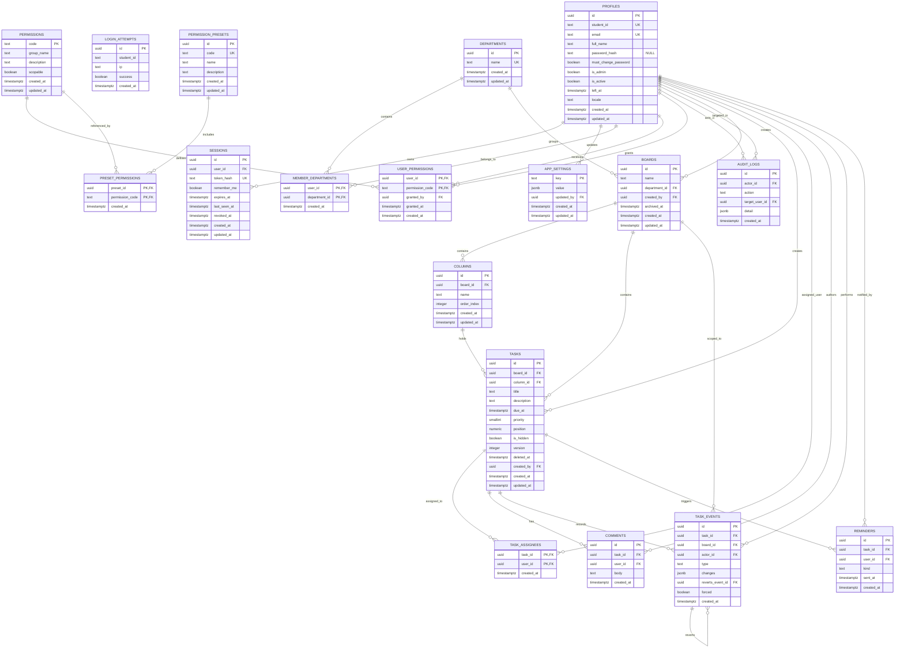

# Entity-Relationship Diagram & Data Dictionary (`docs/ERD.md`)

Tài liệu thiết kế cơ sở dữ liệu PostgreSQL 16 cho hệ thống quản lý thành viên & giao task CLB BEAM, chốt ở giai đoạn **0B (`E0-02`)** dựa trên:
- `docs/HANDOFF-club-management-website.md` v1.4 (mục 8.1, 8.2, 8.6, 8.8, 11.4)
- `docs/DECISIONS.md` (`sessions` table, `WQ-02`, `WQ-05`, `WQ-10`, `WQ-12`, `WQ-19`, `WQ-21`, `WQ-33`, `Q36–Q39`)
- `AGENTS.md` (Phụ lục A — 18 quyền chuẩn, mục 7 — quy tắc bảo mật & nghiệp vụ)

---

## 1. Quy ước thiết kế CSDL

1. **Hệ quản trị & kiểu dữ liệu:** PostgreSQL 16; khóa chính UUID (`gen_random_uuid()`, trừ các bảng danh mục/khóa tự nhiên như `permissions.code`, `app_settings.key`, `schema_migrations.version` và bảng liên kết dùng khóa chính kép); tên bảng `snake_case` số nhiều.
2. **Thời gian:** Lưu UTC `timestamptz`; hiển thị múi giờ `Asia/Ho_Chi_Minh`. Ngày hạn task (`tasks.due_at`) lưu mốc `00:00:00+07` của ngày được chọn (`WQ-12`).
3. **Dấu vết thời gian:** Mọi bảng đều có `created_at`; các bảng có thay đổi dữ liệu (mutable) có thêm `updated_at` tự cập nhật qua trigger `set_updated_at`.
4. **Bảo vệ lịch sử & danh tính:**
   - Mọi khóa ngoại trỏ về `profiles(id)` dùng `ON DELETE RESTRICT` (không bao giờ xóa cascade lịch sử thành viên; thành viên rời CLB dùng `is_active = false`, `left_at`).
   - `profiles.student_id` bất biến sau khi tạo (trigger `prevent_student_id_change`, `WQ-21`).
   - Luôn có ít nhất 1 admin hoạt động (hai trigger `AFTER STATEMENT` với transition tables `prevent_last_active_admin_update` và `prevent_last_active_admin_delete`, khóa đồng thời bằng `pg_advisory_xact_lock`).
   - `task_events` và `audit_logs` là bảng **chỉ ghi thêm** (`append-only`), chặn `UPDATE`/`DELETE`/`TRUNCATE` bằng trigger `prevent_append_only_mutation`.
   - `task_events.changes` chỉ lưu ID và giá trị trường miền, **không lưu** họ tên, MSSV hay email.
   - Không hardcode `@eiu.edu.vn` trong ràng buộc SQL; kiểm tra domain email nằm ở cấu hình máy chủ (`ALLOWED_EMAIL_DOMAIN`).
5. **Xóa mềm & Thùng rác (`Q39`, `WQ-05`, `WQ-33`):**
   - `tasks.deleted_at` giữ vô thời hạn trong MVP (không xóa vĩnh viễn).
   - `columns -> tasks` dùng `ON DELETE RESTRICT` để chặn xóa cột còn task (`409`). Riêng `tasks.column_id` cho phép `NULL` khi `deleted_at IS NOT NULL` (`CHECK (deleted_at IS NOT NULL OR column_id IS NOT NULL)`), giúp service xóa cột có thể dọn `column_id = NULL` cho các task đã nằm sẵn trong Thùng rác và khi khôi phục (`WQ-33`) sẽ đưa về cột đầu tiên của board.

---

## 2. Sơ đồ ERD (18 bảng miền)

> **Ghi chú:** Bảng kỹ thuật `schema_migrations (version PK, applied_at)` quản lý trạng thái chạy lại migration và không nằm trong 18 bảng miền nghiệp vụ. `login_attempts` cố ý không gắn FK tới `profiles` vì phải ghi cả các lần thử với MSSV không tồn tại.

---

## 3. Từ điển dữ liệu chi tiết

### 3.1 `profiles` (Mutable)
Lưu danh tính nội bộ, trạng thái hoạt động, cờ admin và tùy chọn ngôn ngữ email nhắc.

| Cột | Kiểu | Null | Mặc định | Ràng buộc / Ghi chú |
|---|---|---|---|---|
| `id` | `uuid` | NO | `gen_random_uuid()` | `PRIMARY KEY` |
| `student_id` | `text` | NO | — | `UNIQUE` (`profiles_student_id_uq`), bất biến sau khi tạo |
| `email` | `text` | NO | — | Unique không phân biệt hoa thường qua `profiles_email_lower_uq` |
| `full_name` | `text` | NO | — | Hiển thị ở board/task/comment |
| `password_hash` | `text` | YES | `NULL` | Hash `scrypt$N$r$p$salt$hash`; không bao giờ xuất ra API/log |
| `must_change_password` | `boolean` | NO | `false` | Bật `true` khi mới tạo hoặc được Admin đặt lại mật khẩu |
| `is_admin` | `boolean` | NO | `false` | Toàn quyền + quản trị quyền/admin |
| `is_active` | `boolean` | NO | `true` | `false` = đã rời CLB (`"(đã rời)"`) |
| `left_at` | `timestamptz` | YES | `NULL` | Mốc đánh dấu rời CLB |
| `locale` | `text` | NO | `'vi'` | `CHECK (locale IN ('vi', 'en'))` |
| `created_at` | `timestamptz` | NO | `now()` | UTC |
| `updated_at` | `timestamptz` | NO | `now()` | Tự cập nhật bởi `set_updated_at` |

### 3.2 `sessions` (Mutable)
Phiên đăng nhập phía máy chủ dùng opaque token hash; kiểm tra `profiles.is_active` và quyền từ DB mỗi request.

| Cột | Kiểu | Null | Mặc định | Ràng buộc / Ghi chú |
|---|---|---|---|---|
| `id` | `uuid` | NO | `gen_random_uuid()` | `PRIMARY KEY` |
| `user_id` | `uuid` | NO | — | `FK -> profiles(id) ON DELETE RESTRICT` |
| `token_hash` | `text` | NO | — | `UNIQUE` (`sessions_token_hash_uq`), hash của opaque session token |
| `remember_me` | `boolean` | NO | `false` | `false` = TTL 24h; `true` = TTL trượt 30 ngày |
| `expires_at` | `timestamptz` | NO | — | Hạn tối đa của phiên trên server |
| `last_seen_at` | `timestamptz` | NO | `now()` | Cập nhật khi dùng phiên (hỗ trợ gia hạn trượt) |
| `revoked_at` | `timestamptz` | YES | `NULL` | Mốc đăng xuất / thu hồi phiên |
| `created_at` | `timestamptz` | NO | `now()` | UTC |
| `updated_at` | `timestamptz` | NO | `now()` | Tự cập nhật bởi `set_updated_at` |

### 3.3 `login_attempts` (Append log)
Ghi nhật ký đăng nhập phục vụ giới hạn tốc độ theo IP và rà soát bất thường.

| Cột | Kiểu | Null | Mặc định | Ràng buộc / Ghi chú |
|---|---|---|---|---|
| `id` | `uuid` | NO | `gen_random_uuid()` | `PRIMARY KEY` |
| `student_id` | `text` | NO | — | MSSV được nhập (kể cả không tồn tại; không tạo FK) |
| `ip` | `text` | NO | — | Địa chỉ IP nguồn |
| `success` | `boolean` | NO | — | Kết quả xác thực |
| `created_at` | `timestamptz` | NO | `now()` | UTC |

### 3.4 `app_settings` (Mutable)
Cấu hình toàn hệ thống (ví dụ mốc nhắc deadline `'reminders'`).

| Cột | Kiểu | Null | Mặc định | Ràng buộc / Ghi chú |
|---|---|---|---|---|
| `key` | `text` | NO | — | `PRIMARY KEY` |
| `value` | `jsonb` | NO | — | Payload cấu hình JSON |
| `updated_by` | `uuid` | YES | `NULL` | `FK -> profiles(id) ON DELETE RESTRICT` |
| `created_at` | `timestamptz` | NO | `now()` | UTC |
| `updated_at` | `timestamptz` | NO | `now()` | Tự cập nhật bởi `set_updated_at` |

### 3.5 `departments` (Mutable)
Danh sách ban trong CLB (chỉ dùng tổ chức thành viên và nhóm board, không giới hạn quyền).

| Cột | Kiểu | Null | Mặc định | Ràng buộc / Ghi chú |
|---|---|---|---|---|
| `id` | `uuid` | NO | `gen_random_uuid()` | `PRIMARY KEY` |
| `name` | `text` | NO | — | `UNIQUE` (`departments_name_uq`) |
| `created_at` | `timestamptz` | NO | `now()` | UTC |
| `updated_at` | `timestamptz` | NO | `now()` | Tự cập nhật bởi `set_updated_at` |

### 3.6 `member_departments` (Junction)
Liên kết nhiều-nhiều giữa thành viên và ban.

| Cột | Kiểu | Null | Mặc định | Ràng buộc / Ghi chú |
|---|---|---|---|---|
| `user_id` | `uuid` | NO | — | `PK`, `FK -> profiles(id) ON DELETE RESTRICT` |
| `department_id` | `uuid` | NO | — | `PK`, `FK -> departments(id) ON DELETE RESTRICT` |
| `created_at` | `timestamptz` | NO | `now()` | UTC |

### 3.7 `permissions` (Catalog, Mutable via seed/migrations)
Danh mục 18 quyền chuẩn làm một nguồn sự thật ở tầng dữ liệu.

| Cột | Kiểu | Null | Mặc định | Ràng buộc / Ghi chú |
|---|---|---|---|---|
| `code` | `text` | NO | — | `PRIMARY KEY` |
| `group_name` | `text` | NO | — | Nhóm quyền (`members`, `departments`, `boards`, `tasks`, `comments`, `system`) |
| `description` | `text` | NO | — | Mô tả nghiệp vụ |
| `scopable` | `boolean` | NO | `false` | Giữ cho mở rộng giai đoạn 2 |
| `created_at` | `timestamptz` | NO | `now()` | UTC |
| `updated_at` | `timestamptz` | NO | `now()` | Tự cập nhật bởi `set_updated_at` |

### 3.8 `user_permissions` (Grant junction)
Quyền đang cấp cho từng tài khoản (toàn CLB, không hết hạn cho tới khi admin thu hồi).

| Cột | Kiểu | Null | Mặc định | Ràng buộc / Ghi chú |
|---|---|---|---|---|
| `user_id` | `uuid` | NO | — | `PK`, `FK -> profiles(id) ON DELETE RESTRICT` |
| `permission_code` | `text` | NO | — | `PK`, `FK -> permissions(code) ON DELETE RESTRICT` |
| `granted_by` | `uuid` | YES | `NULL` | `FK -> profiles(id) ON DELETE RESTRICT` |
| `granted_at` | `timestamptz` | NO | `now()` | Thời điểm cấp quyền |
| `created_at` | `timestamptz` | NO | `now()` | UTC |

### 3.9 `permission_presets` (Mutable)
Các mẫu quyền gợi ý (`basic_member`, `department_lead`, `hr_manager`).

| Cột | Kiểu | Null | Mặc định | Ràng buộc / Ghi chú |
|---|---|---|---|---|
| `id` | `uuid` | NO | `gen_random_uuid()` | `PRIMARY KEY` |
| `code` | `text` | NO | — | `UNIQUE` (`permission_presets_code_uq`) |
| `name` | `text` | NO | — | Tên hiển thị mẫu quyền |
| `description` | `text` | YES | `NULL` | Mô tả tùy chọn |
| `created_at` | `timestamptz` | NO | `now()` | UTC |
| `updated_at` | `timestamptz` | NO | `now()` | Tự cập nhật bởi `set_updated_at` |

### 3.10 `preset_permissions` (Junction)
Ánh xạ quyền thuộc từng mẫu quyền.

| Cột | Kiểu | Null | Mặc định | Ràng buộc / Ghi chú |
|---|---|---|---|---|
| `preset_id` | `uuid` | NO | — | `PK`, `FK -> permission_presets(id) ON DELETE CASCADE` |
| `permission_code` | `text` | NO | — | `PK`, `FK -> permissions(code) ON DELETE RESTRICT` |
| `created_at` | `timestamptz` | NO | `now()` | UTC |

### 3.11 `audit_logs` (Append-only)
Nhật ký thao tác quản trị (cấp/thu hồi quyền, áp mẫu, bật/tắt admin, quản lý thành viên/ban, cấu hình nhắc). Bị khóa `UPDATE`/`DELETE` bởi trigger.

| Cột | Kiểu | Null | Mặc định | Ràng buộc / Ghi chú |
|---|---|---|---|---|
| `id` | `uuid` | NO | `gen_random_uuid()` | `PRIMARY KEY` |
| `actor_id` | `uuid` | NO | — | `FK -> profiles(id) ON DELETE RESTRICT` |
| `action` | `text` | NO | — | Mã hành động quản trị |
| `target_user_id` | `uuid` | YES | `NULL` | `FK -> profiles(id) ON DELETE RESTRICT` |
| `detail` | `jsonb` | NO | `'{}'::jsonb` | Chi tiết thay đổi (không lưu MSSV/email raw) |
| `created_at` | `timestamptz` | NO | `now()` | UTC |

### 3.12 `boards` (Mutable)
Bảng công việc kiểu Trello; thuộc tối đa 1 ban hoặc chung CLB (`department_id IS NULL`).

| Cột | Kiểu | Null | Mặc định | Ràng buộc / Ghi chú |
|---|---|---|---|---|
| `id` | `uuid` | NO | `gen_random_uuid()` | `PRIMARY KEY` |
| `name` | `text` | NO | — | Tên board |
| `department_id` | `uuid` | YES | `NULL` | `FK -> departments(id) ON DELETE RESTRICT` (`WQ-02`) |
| `created_by` | `uuid` | NO | — | `FK -> profiles(id) ON DELETE RESTRICT` |
| `archived_at` | `timestamptz` | YES | `NULL` | Lưu trữ board thay vì xóa cứng |
| `created_at` | `timestamptz` | NO | `now()` | UTC |
| `updated_at` | `timestamptz` | NO | `now()` | Tự cập nhật bởi `set_updated_at` |

### 3.13 `columns` (Mutable)
Các cột trên một board (ví dụ `Todo`, `Doing`, `Review`, `Done`).

| Cột | Kiểu | Null | Mặc định | Ràng buộc / Ghi chú |
|---|---|---|---|---|
| `id` | `uuid` | NO | `gen_random_uuid()` | `PRIMARY KEY` |
| `board_id` | `uuid` | NO | — | `FK -> boards(id) ON DELETE CASCADE` |
| `name` | `text` | NO | — | Tên cột |
| `order_index` | `integer` | NO | — | Thứ tự cột trên board (cột cuối là Done) |
| `created_at` | `timestamptz` | NO | `now()` | UTC |
| `updated_at` | `timestamptz` | NO | `now()` | Tự cập nhật bởi `set_updated_at` |

### 3.14 `tasks` (Mutable, Soft-delete)
Thẻ công việc trong board; hỗ trợ priority 1..4, vị trí `numeric`, task ẩn, optimistic locking `version`, xóa mềm `deleted_at`.

| Cột | Kiểu | Null | Mặc định | Ràng buộc / Ghi chú |
|---|---|---|---|---|
| `id` | `uuid` | NO | `gen_random_uuid()` | `PRIMARY KEY` |
| `board_id` | `uuid` | NO | — | `FK -> boards(id) ON DELETE RESTRICT` |
| `column_id` | `uuid` | YES | — | `FK -> columns(id) ON DELETE RESTRICT`; `CHECK (deleted_at IS NOT NULL OR column_id IS NOT NULL)` |
| `title` | `text` | NO | — | Tiêu đề task (không đưa vào email nhắc nếu `is_hidden = true`) |
| `description` | `text` | YES | `NULL` | Mô tả chi tiết |
| `due_at` | `timestamptz` | YES | `NULL` | Mốc `00:00 UTC+7` của ngày hạn (`WQ-12`) |
| `priority` | `smallint` | NO | `2` | `CHECK (priority BETWEEN 1 AND 4)` (1 Thấp .. 4 Khẩn) |
| `position` | `numeric` | NO | — | Vị trí sắp xếp liên tục trong cột |
| `is_hidden` | `boolean` | NO | `false` | Chỉ người tạo, người được giao và admin được xem |
| `version` | `integer` | NO | `1` | `CHECK (version >= 1)`, chống ghi đè đồng thời |
| `deleted_at` | `timestamptz` | YES | `NULL` | Xóa mềm, giữ vô thời hạn trong Thùng rác (`Q39`) |
| `created_by` | `uuid` | NO | — | `FK -> profiles(id) ON DELETE RESTRICT` |
| `created_at` | `timestamptz` | NO | `now()` | UTC |
| `updated_at` | `timestamptz` | NO | `now()` | Tự cập nhật bởi `set_updated_at` |

### 3.15 `task_assignees` (Junction)
Danh sách thành viên được giao cho một task.

| Cột | Kiểu | Null | Mặc định | Ràng buộc / Ghi chú |
|---|---|---|---|---|
| `task_id` | `uuid` | NO | — | `PK`, `FK -> tasks(id) ON DELETE CASCADE` |
| `user_id` | `uuid` | NO | — | `PK`, `FK -> profiles(id) ON DELETE RESTRICT` |
| `created_at` | `timestamptz` | NO | `now()` | UTC |

### 3.16 `comments` (Create/Delete)
Bình luận trong task (không chỉnh sửa, không hoàn tác trong MVP).

| Cột | Kiểu | Null | Mặc định | Ràng buộc / Ghi chú |
|---|---|---|---|---|
| `id` | `uuid` | NO | `gen_random_uuid()` | `PRIMARY KEY` |
| `task_id` | `uuid` | NO | — | `FK -> tasks(id) ON DELETE CASCADE` |
| `user_id` | `uuid` | NO | — | `FK -> profiles(id) ON DELETE RESTRICT` |
| `body` | `text` | NO | — | Nội dung bình luận |
| `created_at` | `timestamptz` | NO | `now()` | UTC |

### 3.17 `task_events` (Append-only)
Nhật ký sự kiện cấp task (`task.created`, `task.updated`, `task.moved`, `task.assignees_changed`, `task.hidden_changed`, `task.deleted`, `task.restored`, `comment.added`, `comment.deleted`). Bị khóa `UPDATE`/`DELETE` bởi trigger.

| Cột | Kiểu | Null | Mặc định | Ràng buộc / Ghi chú |
|---|---|---|---|---|
| `id` | `uuid` | NO | `gen_random_uuid()` | `PRIMARY KEY` |
| `task_id` | `uuid` | NO | — | `FK -> tasks(id) ON DELETE RESTRICT` |
| `board_id` | `uuid` | NO | — | `FK -> boards(id) ON DELETE RESTRICT` |
| `actor_id` | `uuid` | NO | — | `FK -> profiles(id) ON DELETE RESTRICT` |
| `type` | `text` | NO | — | Loại sự kiện mở rộng được theo Command Registry |
| `changes` | `jsonb` | NO | `'{}'::jsonb` | Trạng thái trước/sau bằng ID/giá trị miền (không chứa tên/MSSV/email) |
| `reverts_event_id` | `uuid` | YES | `NULL` | `FK -> task_events(id) ON DELETE RESTRICT` |
| `forced` | `boolean` | NO | `false` | `true` khi ghi đè xung đột hoàn tác |
| `created_at` | `timestamptz` | NO | `now()` | UTC |

### 3.18 `reminders` (Idempotent ledger)
Sổ cái chống gửi trùng email nhắc deadline; `kind` là `text` tự do để admin thay đổi mốc trong `app_settings` mà không cần sửa enum CSDL.

| Cột | Kiểu | Null | Mặc định | Ràng buộc / Ghi chú |
|---|---|---|---|---|
| `id` | `uuid` | NO | `gen_random_uuid()` | `PRIMARY KEY` |
| `task_id` | `uuid` | NO | — | `FK -> tasks(id) ON DELETE CASCADE` |
| `user_id` | `uuid` | NO | — | `FK -> profiles(id) ON DELETE RESTRICT` |
| `kind` | `text` | NO | — | Ví dụ `'d2'`, `'d1'`, `'overdue'` |
| `sent_at` | `timestamptz` | NO | `now()` | Thời điểm gửi email thành công |
| `created_at` | `timestamptz` | NO | `now()` | UTC |

---

## 4. Ràng buộc duy nhất, khóa ngoại & chỉ mục

### 4.1 Ràng buộc duy nhất & kiểm tra giá trị
- `profiles_student_id_uq`: `UNIQUE (student_id)` trên `profiles`.
- `profiles_email_lower_uq`: `UNIQUE INDEX (lower(email))` trên `profiles`.
- `profiles_locale_chk`: `CHECK (locale IN ('vi', 'en'))` trên `profiles`.
- `sessions_token_hash_uq`: `UNIQUE (token_hash)` trên `sessions`.
- `departments_name_uq`: `UNIQUE (name)` trên `departments`.
- `departments_name_lower_uq`: `UNIQUE INDEX (lower(btrim(name)))` trên `departments` (chống trùng tên khác hoa/thường hoặc khoảng trắng đầu/cuối).
- `permission_presets_code_uq`: `UNIQUE (code)` trên `permission_presets`.
- `tasks_priority_chk`: `CHECK (priority BETWEEN 1 AND 4)` trên `tasks`.
- `tasks_version_chk`: `CHECK (version >= 1)` trên `tasks`.
- `tasks_active_column_not_null_chk`: `CHECK (deleted_at IS NOT NULL OR column_id IS NOT NULL)` trên `tasks`.
- `reminders_task_user_kind_uq`: `UNIQUE (task_id, user_id, kind)` trên `reminders`.
- Khóa chính kép: `member_departments (user_id, department_id)`, `user_permissions (user_id, permission_code)`, `preset_permissions (preset_id, permission_code)`, `task_assignees (task_id, user_id)`.

### 4.2 Hành vi xóa khóa ngoại (`ON DELETE`)
| Cha -> Con | Cột FK | Hành vi | Lý do |
|---|---|---|---|
| `profiles -> *` | Mọi bảng | `RESTRICT` | Bảo toàn lịch sử thành viên cũ, không xóa cascade |
| `departments -> member_departments, boards` | `department_id` | `RESTRICT` | Hỗ trợ kiểm tra xung đột `409` khi xóa ban còn dữ liệu (`WQ-10`) |
| `permissions -> user_permissions, preset_permissions` | `permission_code` | `RESTRICT` | Không xóa quyền đang được tham chiếu |
| `permission_presets -> preset_permissions` | `preset_id` | `CASCADE` | Xóa mapping khi xóa mẫu quyền |
| `boards -> columns` | `board_id` | `CASCADE` | Cột thuộc hoàn toàn về board |
| `boards -> tasks, task_events` | `board_id` | `RESTRICT` | Bảo toàn lịch sử task |
| `columns -> tasks` | `column_id` | `RESTRICT` | Hỗ trợ chặn xóa cột còn task (`409`, `WQ-05`) |
| `tasks -> task_assignees, comments, reminders` | `task_id` | `CASCADE` | Dữ liệu phụ thuộc trực tiếp vào vòng đời bản ghi task |
| `tasks -> task_events` | `task_id` | `RESTRICT` | Giữ nguyên dấu vết lịch sử task |
| `task_events -> task_events` | `reverts_event_id` | `RESTRICT` | Bảo toàn chuỗi sự kiện hoàn tác |

### 4.3 Chỉ mục hiệu năng
- `tasks_board_column_position_active_idx`: `ON tasks (board_id, column_id, position) WHERE deleted_at IS NULL`
- `tasks_due_at_active_idx`: `ON tasks (due_at) WHERE deleted_at IS NULL AND due_at IS NOT NULL`
- `tasks_board_deleted_at_idx`: `ON tasks (board_id, deleted_at DESC) WHERE deleted_at IS NOT NULL`
- `tasks_created_by_idx`: `ON tasks (created_by)`
- `task_assignees_user_id_idx`: `ON task_assignees (user_id)`
- `comments_task_id_created_at_idx`: `ON comments (task_id, created_at)`
- `task_events_task_id_created_at_idx`: `ON task_events (task_id, created_at DESC)`
- `task_events_reverts_event_id_idx`: `ON task_events (reverts_event_id) WHERE reverts_event_id IS NOT NULL`
- `audit_logs_created_at_idx`: `ON audit_logs (created_at DESC)`
- `audit_logs_target_user_id_created_at_idx`: `ON audit_logs (target_user_id, created_at DESC) WHERE target_user_id IS NOT NULL`
- `login_attempts_ip_created_at_idx`: `ON login_attempts (ip, created_at DESC)`
- `sessions_user_id_idx`: `ON sessions (user_id)`
- `sessions_expires_at_idx`: `ON sessions (expires_at)`
- `member_departments_department_id_idx`: `ON member_departments (department_id)`
- `user_permissions_permission_code_idx`: `ON user_permissions (permission_code)`
- `boards_department_id_idx`: `ON boards (department_id) WHERE department_id IS NOT NULL`
- `columns_board_id_order_index_idx`: `ON columns (board_id, order_index)`

---

## 5. Triggers CSDL

| Trigger | Bảng & Thời điểm | Hàm & Cơ chế | Hint / Mục đích |
|---|---|---|---|
| `prevent_last_active_admin_update` | `profiles` (`AFTER UPDATE REFERENCING OLD TABLE AS old_rows NEW TABLE AS new_rows FOR EACH STATEMENT`) | Nếu có admin hoạt động bị hạ quyền/khóa, khóa `pg_advisory_xact_lock(hashtext('beam_active_admin_guard'))` và kiểm tra `EXISTS (SELECT 1 FROM profiles WHERE is_admin AND is_active)` | `HINT = 'LAST_ACTIVE_ADMIN'` — chống gỡ/khóa admin cuối kể cả lệnh cập nhật nhiều dòng & cạnh tranh đồng thời |
| `prevent_last_active_admin_delete` | `profiles` (`AFTER DELETE REFERENCING OLD TABLE AS old_rows FOR EACH STATEMENT`) | Nếu có admin hoạt động bị xóa, khóa `pg_advisory_xact_lock(hashtext('beam_active_admin_guard'))` và kiểm tra `EXISTS (SELECT 1 FROM profiles WHERE is_admin AND is_active)` | `HINT = 'LAST_ACTIVE_ADMIN'` — chống xóa admin cuối kể cả lệnh xóa nhiều dòng & cạnh tranh đồng thời |
| `prevent_student_id_change` | `profiles` (`BEFORE UPDATE FOR EACH ROW`) | Chặn nếu `NEW.student_id IS DISTINCT FROM OLD.student_id` | `HINT = 'STUDENT_ID_IMMUTABLE'` — khóa MSSV sau khi tạo (`WQ-21`) |
| `prevent_append_only_mutation` | `task_events`, `audit_logs` (`BEFORE UPDATE OR DELETE OR TRUNCATE FOR EACH STATEMENT`) | Từ chối mọi thao tác `UPDATE`, `DELETE` hoặc `TRUNCATE` | `HINT = 'APPEND_ONLY_TABLE'` — đảm bảo nhật ký chỉ ghi thêm (`Q36`, `D35`) |
| `set_updated_at` | `profiles`, `sessions`, `app_settings`, `departments`, `permissions`, `permission_presets`, `boards`, `columns`, `tasks` (`BEFORE UPDATE FOR EACH ROW`) | Gán `NEW.updated_at := now()` | Đồng bộ thời điểm cập nhật UTC |
